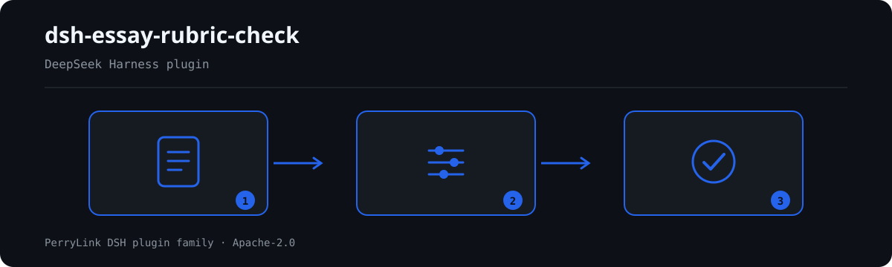

# dsh-essay-rubric-check — निबंध रूब्रिक अंकन-पत्र की जाँच, अंकों, उद्धरण-प्रमाण और अंकगणित पर

[English](README.md) · [简体中文](README-zh.md) · [Español](README-es.md) · [Português](README-pt.md) · [हिन्दी](README-hi.md)

[](https://dsh.market/)
[](https://dshfind.com/en/plugins/PerryLink/dsh-essay-rubric-check?ref=badge)

`dsh-essay-rubric-check` एक अंकन-पत्र पढ़ता है — छात्र का हेडर और प्रत्येक कसौटी की एक पंक्ति — और उसी पत्र की पूर्णता, अंकगणित तथा प्रमाण-श्रृंखला जाँचता है: क्या प्रत्येक कसौटी में नाम या स्तर-विवरण दर्ज है, क्या कोई अंक उस कसौटी के अधिकतम से अधिक नहीं है, क्या कसौटियों के अंकों का जोड़ रूब्रिक के कुल अंक के बराबर है, क्या हर अंकित कसौटी कोई उद्धृत अंश छोड़ती है, क्या कसौटी-क्रमांक दोहराए नहीं गए हैं, और क्या पत्र में छात्र तथा रूब्रिक संस्करण घोषित हैं।

## Install

```sh
dsh plugin --profile <name> add dsh-essay-rubric-check
dsh --profile <name> --dump-config | grep 'dsh-essay-rubric-check'
```

## आउटपुट कैसा दिखता है



*कार्यप्रवाह: दस्तावेज़ → नियम → निष्कर्ष। नीचे के उदाहरण वास्तविक कमांड सतह का उपयोग करते हैं।*


इस प्लगइन का अपने ही `ER-001` टेस्ट फ़िक्स्चर पर वास्तविक आउटपुट — कोई नकली चित्र नहीं। नियम-पैक उद्धरण नहीं गढ़ता, इसलिए हर निष्कर्ष लागू किए गए खंड का नाम और यह भी बताता है कि उसका मूल पाठ इस बार प्राप्त नहीं हुआ।

## यह किन सवालों का जवाब देता है

### उदाहरण

नीचे दी गई तालिका उदाहरण-समुच्चय है: पहली पंक्ति विस्तृत केस है, बाकी संक्षिप्त केस हैं।


| आपका सवाल | इसका जवाब |
|---|---|
| किसी कसौटी में उसके लिए लिखे अधिकतम से अधिक अंक दर्ज है। क्या होता है? | `ER-002` `score` की तुलना `maxScore` से करता है और जिस पंक्ति में अंक अधिकतम से अधिक है उसे दर्ज करता है। यह केवल उन दोनों संख्याओं की तुलना करता है और यह नहीं आँकता कि वह अंक इस निबंध के अनुरूप है या नहीं: यह प्लगइन निबंध को कभी नहीं देखता। |
| कुल-अंक वाला नियम कुछ बताने के बजाय `skipped` में क्यों आता है? | `ER-003` जानबूझकर बिना कॉन्फ़िगर भेजा गया है। उसका व्यंजक एक प्लेसहोल्डर फ़ील्ड `dimensionRef` की ओर संकेत करता है, इसलिए कुछ भी जोड़ा नहीं जाता और नियम स्वयं को `skipped` में दर्ज करता है। अपने रूब्रिक के आयाम-फ़ील्ड `expression.fields` में लिखें, या विवरण-पंक्तियों का जोड़ हेडर के कुल अंक से मिलाने का तरीका चुनें, तब यह चलता है। यह प्लगइन यह नहीं मान लेता कि आपका कुल अंक किन चीज़ों से बनता है। |
| रूब्रिक की दो पंक्तियों में एक ही कसौटी-क्रमांक है। | `ER-005` `criterionNo` में दोहराया गया मान दर्ज करता है, क्योंकि दोहराव से एक कसौटी दो बार दर्ज दिखती है। तुलना करते समय यह श्वेत-स्थान छोड़ देता है। एक ही आयाम को श्रेणियों में अंकित करना सामान्य है: हर श्रेणी को अलग क्रमांक दें, या इस नियम को बंद कर दें। |
| किसी कसौटी में अंक है, पर लेख से कोई उद्धृत अंश नहीं। | `ER-004` उस पंक्ति को दर्ज करता है: केवल जब `score` भरा हो, तब वह `evidenceQuote` की अपेक्षा करता है। यह देखता है कि स्थान-निर्देश वाला खाना भरा है, यह नहीं कि उद्धरण वास्तव में उसी निबंध से है — मनगढ़ंत पर विश्वसनीय लगता उद्धरण इस प्लगइन से पास हो जाता है। |
| कसौटी का नाम और उसका स्तर-विवरण, दोनों खाली हैं। | `ER-001` एक पंक्ति में `criterion` और `levelDesc` में से कम से कम एक की अपेक्षा करता है और जिस पंक्ति में दोनों खाली हैं उसे दर्ज करता है। यह केवल देखता है कि इनमें से एक भरा है, और यह नहीं आँकता कि रूब्रिक की कसौटियाँ ठोस हैं या उनके स्तर-विवरण उपयुक्त हैं। |
| पत्र के हेडर में न यह लिखा है कि यह किस छात्र का है, न यह कि कौन-सा रूब्रिक संस्करण प्रयुक्त हुआ। | `ER-006` हेडर में `student` और `rubricVersion` दोनों घोषित होने की अपेक्षा करता है और जो छूटा हो उसे दर्ज करता है, क्योंकि अंकों का श्रेय नहीं दिया जा सकता और रूब्रिक संस्करण सीधे तुलनीय नहीं होते। ये दोनों हेडर-फ़ील्ड हैं, जो पूरे पत्र के लिए एक बार जाँचे जाते हैं, पंक्ति-दर-पंक्ति नहीं। यदि आपके प्रपत्र में हेडर में जाँच-तिथि भी दर्ज होती है, तो नियम के `fields` में `markedAt` जोड़ दें। |

## यह किन मानकों पर आधारित है

| दस्तावेज़ | संख्यांक | इन्हें उद्धृत करने वाले नियम |
|---|---|---|
| 《普通高中语文课程标准》 | 现行版本与条号本次未核实 | ER-001, ER-002, ER-003, ER-005, ER-006 |
| 《普通高等学校招生全国统一考试评卷工作规定》 | 现行版本与条号本次未核实 | ER-004 |

**Boundary:** this plugin checks a **作文量表评分表** for arithmetic and evidence — that each criterion names
itself and its level description, that a score does not exceed the criterion's maximum, that the criteria total
the rubric's score, that **a scored criterion leaves a quoted excerpt from the writing**, that criterion numbers
are unique, and that the sheet names its student and rubric version. It does **not** decide whether the writing is
good, whether the score is right, whether the comment is apt, or whether a remark should be reviewed.

> ### ⚠️ What this plugin can and cannot do
>
> **It never sees the essay.** So it can check that a score *points at* a quotation — never that the quotation
> comes from that essay, and never that the score suits the writing. `ER-004`'s note says so, and the
> troubleshooting section repeats it: a plausible invented quotation passes this plugin.
>
> **`ER-003` ships deliberately unconfigured.** "Which rows sum to the total" depends on how your rubric divides
> its dimensions — content / structure / language / handwriting, or something else — so the expression points at
> a placeholder field and **computes nothing**. Change `expression.fields` to your rubric's dimension fields, or
> switch to a line-sum + header total, and the rule runs; otherwise it reports itself in `skipped`. **The plugin
> will not assume your total's composition.**
>
> Requiring a quotation for every scored criterion reflects one editorial rule — that marking be reviewable —
> rather than a quotation from a standard. That is why `ER-004` is `warn` and why its note explains how to relax
> it: if some dimensions in your rubric need no quotation, disable the rule or split those dimensions out.
>
> **Every `excerpt` in the rule pack says, in so many words, that the clause text was not obtained.** The regime
> lives in the Chinese language curriculum standards, national marking rules and each school's own rubric. The
> verification pass retrieved neither the clause text nor any rubric, so the pack states the gap in the `excerpt`
> field itself and keeps every rule at `warn` or `info`. **When the texts are in hand, replace each `excerpt`
> with the real clause and raise `kind` to `direct`.**

## Compatibility

| सतह | स्थिति |
|---|---|
| Harness | peer रेंज `>=0.1.2-rc.1 <0.2.0 \|\| >=0.2.0-0 <0.3.0` — `0.2.0-rc.2` और `0.2.1-rc.2` दोनों को स्वीकार करने के लिए सत्यापित। **`engines.dsh` `>=0.2.1-0 <0.3.0` के रूप में घोषित है** और 0.2.1 से होस्ट इसे लागू करता है |
| Node | `^22.19.0 || >=24.0.0` |
| प्लेटफ़ॉर्म | सभी (शुद्ध ESM; कोई नेटिव कोड नहीं, कोई नेटवर्क नहीं, कोई मॉडल कॉल नहीं) |
| टूल मोड | `native` और `ptc` में काम करता है; पूरे फ़ोल्डर के लिए `ptc` चुनें |

## What it does

नियम-सूची, फ़ील्ड और विस्तृत व्यवहार [README.md](README.md#what-it-does) (अंग्रेज़ी मुख्य संस्करण) में हैं। यह प्लगइन केवल उद्धृत धाराओं के सामने शाब्दिक अंतर सूचीबद्ध करता है और हर न चल पाई जाँच को `skipped` में बताता है।

## Configuration

सभी समायोज्य पैरामीटर `src/config.ts` की Schemastery स्कीमा में हैं, इसलिए कोड बदले बिना `cordis.yml` से बदले जा सकते हैं; प्रति-नियम सीमाएँ `rules/` के नियम-पैक में हैं।

| कुंजी | प्रकार | डिफ़ॉल्ट | विवरण |
|---|---|---|---|
| `rulesFile` | string | `rules/essay-rubric-check.yaml` | नियम-पैक का पथ, पैकेज रूट के सापेक्ष |
| `disabledRules` | string[] | `[]` | बंद करने वाले नियम id; प्रत्येक `skipped` में दिखता है |
| `onlyRules` | string[] | `[]` | केवल ये नियम चलाएँ; खाली होने पर सभी नियम चलते हैं |
| `skipNotes` | string | `""` | हर `skipped` कारण के आगे जोड़ी जाने वाली टिप्पणी |
| `timeoutMs` | number | `120000` | उपकरण का सहकारी समय-सीमा बजट |

## Material format

JSON या YAML स्वीकार्य है। पूरा फ़ील्ड उदाहरण [README.md](README.md#material-format) (अंग्रेज़ी मुख्य संस्करण) में है। पढ़ने की परत में फ़ील्ड वैकल्पिक हैं और जाँच इंजन उन्हें सत्यापित करता है, इसलिए आंशिक निर्यात पर क्रैश के बजाय "अनुपस्थित" श्रेणी के निष्कर्ष मिलते हैं।

## Rule sources

नियम-डेटा कोड से अलग है: प्रत्येक नियम में दस्तावेज़, संख्या, स्रोत की अपनी क्रमांकन-प्रणाली के अनुसार धारा, शब्दशः उद्धरण और स्रोत URL होता है। लोडर लागू करता है कि उद्धरण कम से कम आठ अक्षरों का वास्तविक उद्धरण हो, और जिस जाँच का आधार केवल सामान्य सिद्धांत (`kind: derived-from-principle`, अधिकतम `warn`) या स्थानीय नीति (`kind: institutional-configuration`, अधिकतम `info`) हो, उसे कभी `error` घोषित न किया जाए।

सत्यापित सीमाएँ और जान-बूझकर **न** कहे गए निष्कर्ष [README.md](README.md#rule-sources) (अंग्रेज़ी मुख्य संस्करण) और `rules/evidence/` में हैं।

## Troubleshooting

- **प्लगइन इंस्टॉल हो गया पर टूल दिखता नहीं**: जाँचें कि `main` `lib/index.mjs` पर जाता है और `pnpm run build` ने उसे बनाया है।
- **`dsh plugin add` असंगत बताकर मना करता है**: peer range `0.1.x` और `0.2.x` दोनों को कवर करती है; बाहर होने पर स्पष्ट छूट दें: `dsh plugin --profile <name> allow-version <pkg@ver> --dsh-version <runtime> --accept-risk`।
- **कोई नियम नहीं चला**: `skipped` सरणी देखें।
- **`check` में `manifest-peers` विफल दिखता है**: यह `dsh-plugin-dev` की ज्ञात अपस्ट्रीम समस्या है; रनटाइम इंस्टॉल के समय अनुकूलता लागू करता है।
- **समय खिसका हुआ लगता है**: सारी गणना दिए गए स्ट्रिंग पर वॉल-क्लॉक है।

## Development

```sh
pnpm install
pnpm run typecheck
pnpm test
pnpm run build
node ../scripts/sync-shared.mjs dsh-essay-rubric-check
```

अंतिम कमांड `../_shared` का साझा किट `src/shared/` में कॉपी करता है; हर साझा बदलाव के बाद इसे दोबारा चलाएँ।

## PerryLink DSH Plugin Family

यह प्रोजेक्ट [PerryLink](https://github.com/PerryLink) के DeepSeek Harness प्लगइन परिवार का हिस्सा है। पूरी सूची नीचे संक्षिप्त रखी गई है ताकि हर README की पहली स्क्रीन छोटी रहे; हर पंक्ति और उसकी स्थिति देखने के लिए इसे खोलें।

<details>
<summary>सभी प्लगइन खोलें</summary>

| प्लगइन | स्थिति |
|---|---|
| **[dsh-aqua-input-check](https://github.com/PerryLink/dsh-aqua-input-check)** |  |
| **[dsh-archive-check](https://github.com/PerryLink/dsh-archive-check)** |  |
| **[dsh-auto-review](https://github.com/PerryLink/dsh-auto-review)** |  |
| **[dsh-autotier](https://github.com/PerryLink/dsh-autotier)** |  |
| **[dsh-bid-ca-precheck](https://github.com/PerryLink/dsh-bid-ca-precheck)** |  |
| **[dsh-bid-qual-check](https://github.com/PerryLink/dsh-bid-qual-check)** |  |
| **[dsh-cert-mcp](https://github.com/PerryLink/dsh-cert-mcp)** |  |
| **[dsh-checkpoint-rewind](https://github.com/PerryLink/dsh-checkpoint-rewind)** |  |
| **[dsh-click](https://github.com/PerryLink/dsh-click)** |  |
| **[dsh-composer-history](https://github.com/PerryLink/dsh-composer-history)** |  |
| **[dsh-contract-stance](https://github.com/PerryLink/dsh-contract-stance)** |  |
| **[dsh-customs-doc-check](https://github.com/PerryLink/dsh-customs-doc-check)** |  |
| **[dsh-data-quality](https://github.com/PerryLink/dsh-data-quality)** |  |
| **[dsh-demurrage-ledger](https://github.com/PerryLink/dsh-demurrage-ledger)** |  |
| **[dsh-doublecheck](https://github.com/PerryLink/dsh-doublecheck)** |  |
| **[dsh-drill-script-check](https://github.com/PerryLink/dsh-drill-script-check)** |  |
| **[dsh-eia-guide-check](https://github.com/PerryLink/dsh-eia-guide-check)** |  |
| **[dsh-emergency-plan](https://github.com/PerryLink/dsh-emergency-plan)** |  |
| **[dsh-essay-rubric-check](https://github.com/PerryLink/dsh-essay-rubric-check)** |  |
| **[dsh-evidence-check](https://github.com/PerryLink/dsh-evidence-check)** |  |
| **[dsh-export-ctl-check](https://github.com/PerryLink/dsh-export-ctl-check)** |  |
| **[dsh-fast](https://github.com/PerryLink/dsh-fast)** |  |
| **[dsh-fmea-table-check](https://github.com/PerryLink/dsh-fmea-table-check)** |  |
| **[dsh-forecast-penalty](https://github.com/PerryLink/dsh-forecast-penalty)** |  |
| **[dsh-fund-research](https://github.com/PerryLink/dsh-fund-research)** |  |
| **[dsh-github](https://github.com/PerryLink/dsh-github)** |  |
| **[dsh-gongwen-flow-check](https://github.com/PerryLink/dsh-gongwen-flow-check)** |  |
| **[dsh-gongwen-word-check](https://github.com/PerryLink/dsh-gongwen-word-check)** |  |
| **[dsh-guard-plan-qc](https://github.com/PerryLink/dsh-guard-plan-qc)** |  |
| **[dsh-hazchem-check](https://github.com/PerryLink/dsh-hazchem-check)** |  |
| **[dsh-hazplan-check](https://github.com/PerryLink/dsh-hazplan-check)** |  |
| **[dsh-hidden-risk-map](https://github.com/PerryLink/dsh-hidden-risk-map)** |  |
| **[dsh-hs-classify](https://github.com/PerryLink/dsh-hs-classify)** |  |
| **[dsh-icd-rule-check](https://github.com/PerryLink/dsh-icd-rule-check)** |  |
| **[dsh-industry-research](https://github.com/PerryLink/dsh-industry-research)** |  |
| **[dsh-lawcite-adapter](https://github.com/PerryLink/dsh-lawcite-adapter)** |  |
| **[dsh-laya](https://github.com/PerryLink/dsh-laya)** |  |
| **[dsh-lc-doc-check](https://github.com/PerryLink/dsh-lc-doc-check)** |  |
| **[dsh-learning-gap-check](https://github.com/PerryLink/dsh-learning-gap-check)** |  |
| **[dsh-library](https://github.com/PerryLink/dsh-library)** |  |
| **[dsh-local-ai](https://github.com/PerryLink/dsh-local-ai)** |  |
| **[dsh-lsp-actions](https://github.com/PerryLink/dsh-lsp-actions)** |  |
| **[dsh-mask](https://github.com/PerryLink/dsh-mask)** |  |
| **[dsh-mcp-panel](https://github.com/PerryLink/dsh-mcp-panel)** |  |
| **[dsh-medrec-qc](https://github.com/PerryLink/dsh-medrec-qc)** |  |
| **[dsh-memento](https://github.com/PerryLink/dsh-memento)** |  |
| **[dsh-nsfc-form-check](https://github.com/PerryLink/dsh-nsfc-form-check)** |  |
| **[dsh-nurse-record-check](https://github.com/PerryLink/dsh-nurse-record-check)** |  |
| **[dsh-observe](https://github.com/PerryLink/dsh-observe)** |  |
| **[dsh-origin-rvc-check](https://github.com/PerryLink/dsh-origin-rvc-check)** |  |
| **[dsh-ota-review-check](https://github.com/PerryLink/dsh-ota-review-check)** |  |
| **[dsh-output-styles](https://github.com/PerryLink/dsh-output-styles)** |  |
| **[dsh-paper-doc-adapter](https://github.com/PerryLink/dsh-paper-doc-adapter)** |  |
| **[dsh-permission-rules](https://github.com/PerryLink/dsh-permission-rules)** |  |
| **[dsh-permit-report-check](https://github.com/PerryLink/dsh-permit-report-check)** |  |
| **[dsh-pipeline-check](https://github.com/PerryLink/dsh-pipeline-check)** |  |
| **[dsh-pleading-draft](https://github.com/PerryLink/dsh-pleading-draft)** |  |
| **[dsh-plugin-doctor](https://github.com/PerryLink/dsh-plugin-doctor)** |  |
| **[dsh-plugin-guide](https://github.com/PerryLink/dsh-plugin-guide)** |  |
| **[dsh-plugin-kit](https://github.com/PerryLink/dsh-plugin-kit)** |  |
| **[dsh-plugin-upgrade](https://github.com/PerryLink/dsh-plugin-upgrade)** |  |
| **[dsh-policy-brief-draft](https://github.com/PerryLink/dsh-policy-brief-draft)** |  |
| **[dsh-power-loss-split](https://github.com/PerryLink/dsh-power-loss-split)** |  |
| **[dsh-power-ticket-check](https://github.com/PerryLink/dsh-power-ticket-check)** |  |
| **[dsh-ppap-check](https://github.com/PerryLink/dsh-ppap-check)** |  |
| **[dsh-protest-deadline](https://github.com/PerryLink/dsh-protest-deadline)** |  |
| **[dsh-railway-window](https://github.com/PerryLink/dsh-railway-window)** |  |
| **[dsh-repair-order-qc](https://github.com/PerryLink/dsh-repair-order-qc)** |  |
| **[dsh-research-report](https://github.com/PerryLink/dsh-research-report)** |  |
| **[dsh-review-reply-check](https://github.com/PerryLink/dsh-review-reply-check)** |  |
| **[dsh-rulefile-check](https://github.com/PerryLink/dsh-rulefile-check)** |  |
| **[dsh-safety-brief-check](https://github.com/PerryLink/dsh-safety-brief-check)** |  |
| **[dsh-score](https://github.com/PerryLink/dsh-score)** |  |
| **[dsh-session-sync](https://github.com/PerryLink/dsh-session-sync)** |  |
| **[dsh-site-log-check](https://github.com/PerryLink/dsh-site-log-check)** |  |
| **[dsh-skill-pack-security](https://github.com/PerryLink/dsh-skill-pack-security)** |  |
| **[dsh-soe-decision-check](https://github.com/PerryLink/dsh-soe-decision-check)** |  |
| **[dsh-soilwater-check](https://github.com/PerryLink/dsh-soilwater-check)** |  |
| **[dsh-sop-sync-check](https://github.com/PerryLink/dsh-sop-sync-check)** |  |
| **[dsh-spc-gbt-adapter](https://github.com/PerryLink/dsh-spc-gbt-adapter)** |  |
| **[dsh-talk](https://github.com/PerryLink/dsh-talk)** |  |
| **[dsh-tender-extract](https://github.com/PerryLink/dsh-tender-extract)** |  |
| **[dsh-tender-matrix](https://github.com/PerryLink/dsh-tender-matrix)** |  |
| **[dsh-test-drive](https://github.com/PerryLink/dsh-test-drive)** |  |
| **[dsh-ticktick](https://github.com/PerryLink/dsh-ticktick)** |  |
| **[dsh-translate](https://github.com/PerryLink/dsh-translate)** |  |
| **[dsh-warranty-calc](https://github.com/PerryLink/dsh-warranty-calc)** |  |
| **[dsh-budget](https://github.com/PerryLink/dsh-budget)** | 🧊 फ़्रोज़न — रिपॉज़िटरी README देखें |
| **[dsh-claude-move](https://github.com/PerryLink/dsh-claude-move)** | 🧊 फ़्रोज़न — रिपॉज़िटरी README देखें |
| **[dsh-defend](https://github.com/PerryLink/dsh-defend)** | 🧊 फ़्रोज़न — रिपॉज़िटरी README देखें |
| **[dsh-draw](https://github.com/PerryLink/dsh-draw)** | 🧊 फ़्रोज़न — रिपॉज़िटरी README देखें |
| **[dsh-reach](https://github.com/PerryLink/dsh-reach)** | 🧊 फ़्रोज़न — रिपॉज़िटरी README देखें |
| **[dsh-background-agents](https://github.com/PerryLink/dsh-background-agents)** | 🚫 सेवानिवृत्त — रिपॉज़िटरी README देखें |
| **[dsh-session-pin](https://github.com/PerryLink/dsh-session-pin)** | 🚫 सेवानिवृत्त — रिपॉज़िटरी README देखें |
| **[dsh-team-rooms](https://github.com/PerryLink/dsh-team-rooms)** | 🚫 सेवानिवृत्त — रिपॉज़िटरी README देखें |

</details>

## License

[Apache License 2.0](LICENSE) © 2026 dsh-essay-rubric-check contributors.
