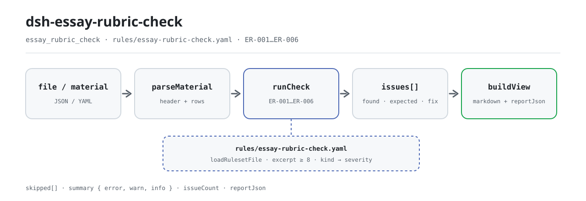

<div align="center">

<picture>
  <source media="(prefers-color-scheme: dark)" srcset="docs/assets/dsh-essay-rubric-check-flow-dark.svg">
  
</picture>

# dsh-essay-rubric-check

**Turn one essay rubric sheet into a point-by-point list of what is inconsistent — which row, which field, what is missing, and how to fix it.**

A rubric scoring-sheet checker for teaching researchers, Chinese-language teachers, and marking teams: it reads the student header plus one row per criterion, checks completeness, arithmetic, quotation evidence, criterion-number uniqueness, and sheet ownership, and lists differences without deciding anything for the reviewer.

[Install](#three-step-setup) · [Configuration](#configuration) · [FAQ](#faq) · [简体中文](README.md) · [English](README.en.md) · [Español](README.es.md) · [Português](README.pt.md) · [हिन्दी](README.hi.md)

[](LICENSE)
[](#compatibility)
[](https://www.npmjs.com/package/dsh-essay-rubric-check)
[](https://github.com/PerryLink/dsh-essay-rubric-check/actions/workflows/ci.yml)
[](#compatibility)

[](https://github.com/PerryLink/dsh-essay-rubric-check/stargazers)
[](https://www.npmjs.com/package/dsh-essay-rubric-check)
[](https://dshfind.com/plugins/PerryLink/dsh-essay-rubric-check?ref=badge)
[](https://securityscorecards.dev/viewer/?uri=github.com/PerryLink/dsh-essay-rubric-check)
[](https://dsh.market/)
[](https://gitee.com/perrylink/dsh-essay-rubric-check)

```sh
dsh plugin --profile <name> add dsh-essay-rubric-check
```

</div>

<sub>Community plugin, not affiliated with DeepSeek. Canonical repository: <https://github.com/PerryLink/dsh-essay-rubric-check> (Gitee is a mirror).</sub>

## What it is

`dsh-essay-rubric-check` reads one **essay rubric sheet** — the student header plus one row per criterion — and checks that sheet's own completeness, arithmetic, and evidence trail: whether each criterion records a name or a level description, whether a score stays within that criterion's maximum, whether the criterion scores total the rubric's score, whether every scored criterion leaves a quoted excerpt from the writing, whether criterion numbers are unique, and whether the sheet names its student and rubric version. It lists only the differences it can point to in the material; it never decides whether the writing is good, whether the score is right, or whether a comment is apt.

It registers one model-facing tool, `essay_rubric_check`: the material is JSON or YAML (`file` and `material` are mutually exclusive), and the output is a `markdown` report plus `reportJson` and `summary` counts. Every check that could not run is listed in `skipped` with its reason — it is never silently treated as "nothing is wrong".

Built for teaching researchers, Chinese-language teachers, and marking teams: export the rubric sheet to JSON/YAML for batch checking; the original file is read-only and never modified.

## Three-step setup

1. **Install** (pick one channel):

   ```sh
   # git channel (latest main; equivalent to git+https://github.com/PerryLink/dsh-essay-rubric-check.git)
   dsh plugin --profile web add github:PerryLink/dsh-essay-rubric-check
   # npm channel (published releases)
   dsh plugin --profile web add dsh-essay-rubric-check
   # tarball channel: pnpm pack in this repo (prepare builds lib/ first)
   dsh plugin --profile web add ./dsh-essay-rubric-check-<version>.tgz
   ```

2. **Minimal config** (the defaults work; configure only to disable rules, run a subset, or point at another rule pack):

   ```yaml
   - insert:
       - id: dsh-essay-rubric-check
         name: dsh-essay-rubric-check
         config:
           disabledRules: []
           onlyRules: []
           timeoutMs: 120000
   ```

   `cordis.patch.yml` only inserts this row; every tunable lives in the Schemastery schema in `src/config.ts`.

3. **Verify it mounts**:

   ```sh
   dsh --profile web --dump-config | grep -A2 'id: dsh-essay-rubric-check'
   node samples/quickstart/run.mjs
   ```

   The `ER-001-unsafe.json` sample is expected to produce 1 warn and 1 skipped (`ER-003` is unconfigured; see FAQ).

**Uninstall**: `dsh plugin --profile web remove dsh-essay-rubric-check` (or remove the row from the profile patch).

<details>
<summary>Use it from WorkBuddy / Coze</summary>

Search for “Teaching and Review Suite” in WorkBuddy / Coze (this check is one part of it; availability as listed). Command-line installation remains the command above.

</details>

## Core capabilities

The tool is named `essay_rubric_check`. It reads a rubric sheet shaped as "student header + one row per criterion", applies a versioned rule pack, and returns a report that can be reviewed line by line.

- **Six built-in rules** — completeness, score ceiling, total, quotation evidence, criterion-number uniqueness, and header ownership; all at `warn`.
- **The rule pack is data** — rules live in `rules/essay-rubric-check.yaml`; replacing the file switches the rule set without touching TypeScript. The pack is validated on load, not trusted.
- **No silent skips** — `skipped` names every rule that could not run and why; `summary` reports error / warn / info counts, so an empty issue list cannot be misread as "all correct".
- **Read-only, local, no model call** — pure parsing and arithmetic; no network, no modification of the original, no model invocation.
- **Two input shapes** — `file` (an absolute JSON/YAML path) or `material` (inline text); `args.only` narrows the run to selected rules.

### Rules

| Rule | What it checks | Severity | Basis kind |
|---|---|---|---|
| `ER-001` | the criterion and its level description are recorded | warn | principle |
| `ER-002` | a score does not exceed the criterion's maximum | warn | principle |
| `ER-003` | the criteria total the rubric score (unconfigured by default) | warn | principle |
| `ER-004` | a scored criterion leaves a quoted excerpt | warn | principle |
| `ER-005` | criterion numbers are unique | warn | principle |
| `ER-006` | the sheet names its student and rubric version | warn | principle |

### Examples

**Tool** `essay_rubric_check`

**Input**

~~~json
{"rows":[{"序号":"1","评分项":"","维度":"内容","等级描述":"","得分":"18", ...}]}
~~~

**Output**

~~~json
{
  "id": "dsh-essay-rubric-check.ER-001.de09b5a6",
  "ruleId": "ER-001",
  "severity": "warn",
  "locator": {
    "row": 1,
    "field": "criterion"
  },
  "found": "第 1 行 criterion、levelDesc 都为空",
  "expected": "criterion、levelDesc 至少应填写一项",
  "fix": "补填评分项与等级描述；本条只核对是否填写，不判断量表是否合理"
}
~~~

*Observed from `dsh-essay-rubric-check/tests/fixtures/ER-001/ER-001-unsafe.json; dsh-essay-rubric-check/tests/fixtures/ER-001/cases.json; dsh-essay-rubric-check/rules/essay-rubric-check.yaml; dsh-essay-rubric-check/tests/index.test.ts`*

| You ask | What it answers |
|---|---|
| One criterion carries a score above the maximum written for it. What happens? | `ER-002` compares `score` with `maxScore` and reports the row where the score exceeds the maximum. It only compares the two numbers, and it does not judge whether that score suits this essay: the plugin never sees the writing. |
| Why does the total rule appear in `skipped` instead of reporting anything? | `ER-003` ships deliberately unconfigured. Its expression points at a placeholder field, `dimensionRef`, so nothing is added up and the rule reports itself in `skipped`. Name your rubric's own dimension fields in `expression.fields`, or switch to summing the detail rows against the header total, and it runs. The plugin will not assume how your total is composed. |
| The same criterion number is used on two rows of the rubric. | `ER-005` reports a repeated value in `criterionNo`, because a duplicate makes a criterion look registered twice. It ignores whitespace when comparing. Scoring one dimension in bands is a legitimate shape: give each band its own number, or disable the rule. |
| A criterion has a score but no quoted excerpt from the writing. | `ER-004` reports that row: only where `score` is filled does it require `evidenceQuote`. It checks that the locating cell is filled, not that the quotation really comes from that essay — a plausible invented quotation passes this plugin. |
| Both the criterion name and its level description are blank. | `ER-001` requires at least one of `criterion` and `levelDesc` on a row and reports the row where both are empty. It only checks that one of them is filled, and does not judge whether the rubric's criteria are sound or its level descriptions apt. |
| The sheet header does not say which student it belongs to, or which rubric version was used. | `ER-006` requires the header to declare both `student` and `rubricVersion`, and reports the missing one, because scores cannot be attributed and rubric versions are not directly comparable. Both are header fields, checked once for the sheet rather than per row. If your form also records a marking date in the header, add `markedAt` to the rule's `fields`. |

### Material format

JSON or YAML. Column names are matched case-insensitively and ignoring spaces, underscores, and hyphens; the sheet's own column names are kept, so a finding names the column it read.

```yaml
student: 某某考生
assignment: 某某作文题
rubricName: 某某作文评分量表
rubricVersion: 2026 版
totalScore: '18'
fullScore: '20'
markedAt: 2026-04-10
rows:
  - { 序号: '1', 评分项: 内容, 分值: '20',
      等级描述: 切合题意，中心突出，内容充实，感情真挚（一类卷 17—20 分）,
      得分: '18', 原文定位: '"他把那盏灯擦了三遍，直到玻璃上映出自己的影子。"',
      所在段落: 第 4 段, 评语: 以细节支撑情感，内容充实，符合一类卷标准。, 评分人: 王老师 }
```

### Standards it follows

| Document | Number | Cited by rules |
|---|---|---|
| Chinese Language Curriculum Standards for Senior Secondary School | Current version and clause number not verified in this pass | ER-001, ER-002, ER-003, ER-005, ER-006 |
| National Unified Examination for Admissions to General Universities and Colleges — marking work regulations | Current version and clause number not verified in this pass | ER-004 |

**Boundary:** this plugin checks an **essay rubric sheet** for arithmetic and evidence — that each criterion names itself and its level description, that a score does not exceed the criterion's maximum, that the criteria total the rubric's score, that **a scored criterion leaves a quoted excerpt from the writing**, that criterion numbers are unique, and that the sheet names its student and rubric version. It does **not** decide whether the writing is good, whether the score is right, whether the comment is apt, or whether a remark should be reviewed.

> ### ⚠️ Read this before trusting a citation in the report
>
> **`excerpt` status is per rule, not uniform.** Some rules quote the clause verbatim (`kind: direct`), some are derived from the principle of the cited articles (`kind: derived-from-principle`, capped at `warn`), and some use thresholds your institution configures (`kind: institutional-configuration`, capped at `info`). The pack never paraphrases a quotation: when the text was not obtained, the `excerpt` field says so and the reasoning lives in `note`; a test asserts that no rule claims a quotation it does not have. **For any rule still marked as not obtained, replace the `excerpt` with the real clause and raise `kind` to `direct` once the text is in hand.**
>
> The conclusion is the reviewer's: this plugin lists differences it can point to in the material and does not decide facts or compliance.

Rule data lives apart from code: every rule carries a document, a number, a clause in the source's own numbering, a verbatim excerpt, and a source URL. Load-time guards require the excerpt to be a real quotation of at least eight characters; checks derived only from a general principle (`kind: derived-from-principle`) are capped at `warn`, and checks driven by an institution's own thresholds (`kind: institutional-configuration`) are capped at `info`. The verified boundaries and the conclusions deliberately **not** asserted are recorded under the shipped `rules/evidence/` directory.

## Configuration

Every tunable lives in the Schemastery schema in `src/config.ts`, so it can be changed from the profile config without editing code; per-rule thresholds live in the rule pack under `rules/`.

| Key | Type | Default | Description |
|---|---|---|---|
| `rulesFile` | string | `rules/essay-rubric-check.yaml` | Rule-pack path, relative to the package root |
| `disabledRules` | string[] | `[]` | Rule ids to stop running; each appears in `skipped` |
| `onlyRules` | string[] | `[]` | Run only these rule ids; empty runs every rule |
| `skipNotes` | string | `""` | Note appended to every `skipped` reason |
| `timeoutMs` | number | `120000` | Cooperative tool timeout budget |

<details>
<summary>Rule-level parameters (edit the rule pack, not Config)</summary>

- `ER-003` `expression` — **must be configured before it does anything.** Either name your dimension fields
  (`{ "op": "sum", "fields": ["contentScore", "languageScore"] }`) or sum the detail lines against a header
  total; the shipped expression points at a placeholder and computes nothing.
- `ER-002` `leftField` / `rightField` / `relation` — the comparison, `score <= maxScore` by default.
- `ER-004` `conditionField` / `requiredFields` — what triggers the quotation requirement.

</details>

Profile patch override example:

```yaml
- insert:
    - id: dsh-essay-rubric-check
      name: dsh-essay-rubric-check
      config:
        onlyRules: [ER-001, ER-002, ER-004]
        skipNotes: this run checks completeness, arithmetic and evidence only
```

## FAQ

<details>
<summary>Is the material uploaded? Where is the data stored?</summary>

No. The plugin reads the document content passed to its tool and makes no network requests, ships no telemetry or background reporting, and writes nothing outside the tool result and the DSH host's own session/log storage. The host controls that storage and its retention; this package does not add a second copy. Removing the package removes its code; it does not delete host session logs or documents you already created.

</details>

<details>
<summary>Why is `ER-003` in `skipped`? Is the total being missed?</summary>

It is deliberately unconfigured, not missed. "Which rows sum to the total" depends on how your rubric divides its dimensions (content / structure / language / handwriting, or something else), so the shipped expression points at a placeholder field, `dimensionRef`, and **computes nothing**; the rule reports itself in `skipped` instead of guessing. Name your dimension fields in `expression.fields`, or switch to a line-sum against the header total, and the rule runs. **The plugin will not assume your total's composition.**

</details>

<details>
<summary>Can an invented quotation pass?</summary>

Yes. `ER-004` only checks that the locating cell is filled when a score is filled; it never checks that the quotation appears in the essay — comparing needs the essay, which the plugin does not see. A plausible invented quotation passes this rule.

</details>

<details>
<summary>What is the performance cost?</summary>

Parsing one rubric sheet plus six literal rule checks is local arithmetic: no network requests and no model calls. `timeoutMs` is only the cooperative tool timeout budget, 120 seconds by default; normal material is far below it.

</details>

<details>
<summary>Will it collide with other plugins over tool names or services?</summary>

No. It registers exactly one tool, `essay_rubric_check`, and provides no service key, command, client slot, HTTP route, or global mutation; registration is disposed with the plugin. See “Interoperability with other DSH plugins”.

</details>

## Troubleshooting

- **`ER-003` reports itself as skipped.** Its expression still points at the placeholder field. Configure the dimension fields or the line-sum form — the plugin will not assume your total's composition.
- **`ER-004` passed an invented quotation.** It checks that a quotation is *present*, never that it appears in the essay. Comparing needs the essay, which the plugin does not see.
- **`ER-004` fires on a criterion that needs no quotation.** Disable the rule, or split that criterion into a rubric of its own.
- **`ER-002` fires on a score equal to the maximum.** Equality is allowed; a finding means the score is larger.
- **`ER-005` fires on two rows for one dimension.** Band rows within a dimension are legitimate — number them apart.
- **The plugin installs but the tool never appears.** Check that `main` resolves to `lib/index.mjs` and that `pnpm run build` produced it; a wrong `main` makes the loader skip the entry silently.
- **`dsh plugin add` refuses the package as incompatible.** The peer range covers `0.1.x` and `0.2.x`; if your runtime sits outside it, grant an explicit exemption: `dsh plugin --profile <name> allow-version dsh-essay-rubric-check@0.2.10 --dsh-version <runtime> --accept-risk`.
- **`check` reports `manifest-peers` as failed.** The static checker compares against a hard-coded peer range that predates the 0.2 line. The runtime enforces peer compatibility at install time, so the declared range is the correct one; this is a known upstream issue in `dsh-plugin-dev`.

## Security boundaries & known limitations

- **It sees the rubric sheet, never the essay.** `ER-002` only compares two numbers and cannot judge whether a score suits the writing; `ER-004` only checks that the locating cell is filled and cannot verify the quotation. These are the plugin's most important capability limits.
- **No compliance verdict, no liability finding, no replacement for the reviewer.** The report lists differences it can point to in the material and always carries the disclaimer; the conclusion belongs to the grader and to marking-quality management.
- **Excerpt status is per rule, and most clauses were not obtained.** The pack states “the clause text was not obtained” in each `excerpt` and caps severity by evidence: `derived-from-principle` at `warn`, `institutional-configuration` at `info`, and only `direct` may carry `error`. A test asserts that no rule claims a quotation it does not have; when the real clause is in hand, replace the `excerpt` and raise `kind` to `direct`.
- **`ER-003` computes no total by default.** The shipped expression points at the placeholder field `dimensionRef`; without configuration there is no total check, and the rule says so in `skipped` instead of passing silently.
- **An empty issue list is never "nothing is wrong".** Every check that could not run appears in `skipped` with its reason; a rule whose required list is unset reports itself in `skipped` rather than passing.
- **Load-time validation.** A pack whose excerpt is shorter than eight characters or whose severity outruns its basis kind fails on load instead of producing a confident-looking report.
- **Read-only and local.** It reads the input file and never writes back to the original; there are no network requests, no telemetry, and no model calls.

## Interoperability with other DSH plugins

- **One tool only.** `essay_rubric_check` is registered through the standard `tools` service (`inject: ['tools']`); the plugin provides no service key, command, client slot, or HTTP route, and mutates no global object.
- **Registration is an effect.** The registration returns a disposer, so unloading or hot-reloading the plugin removes the tool entry with no residue.
- **Pure ESM, no native code.** It pulls in no native module, starts no subprocess, and opens no network connection, so it can share a profile with any other DSH plugin.
- **I/O stays on the standard tool surface.** It consumes only the caller's `file` / `material` and returns the report as the tool result; it listens to no session event and competes for no event chain.

## Compatibility

| Surface | Status |
|---|---|
| Harness | Peer range `>=0.1.2-rc.1 <0.2.0 \|\| >=0.2.0-0 <0.3.0` — verified to accept both `0.2.0-rc.2` and `0.2.1-rc.2`. **`engines.dsh` is declared as `>=0.2.1-0 <0.3.0`** and is enforced by the host since 0.2.1 |
| Node | `^22.19.0 \|\| >=24.0.0` |
| Platforms | All (plain ESM; no native code, no network, no model call) |
| Tool mode | Works in `native` and `ptc`; for batch-checking several rubric sheets use `ptc`, so the schema cost is paid once |

## Ecosystem & quality

- [Gitee mirror](https://gitee.com/perrylink/dsh-essay-rubric-check) (synchronized mirror; GitHub is canonical)
- [dshfind plugin page](https://dshfind.com/plugins/PerryLink/dsh-essay-rubric-check) (installs and rank)
- [OpenSSF Scorecard report](https://securityscorecards.dev/viewer/?uri=github.com/PerryLink/dsh-essay-rubric-check) (driven by [.github/workflows/scorecard.yml](.github/workflows/scorecard.yml))
- [DSH Market](https://dsh.market/) (listed)
- [Ecosystem knowledge base](https://perrylink.github.io/dsh-plugin-guide/): plugin development guide · selection measurements · maintenance trade-offs

## Development

```sh
pnpm install
pnpm run typecheck
pnpm test
pnpm run build
pnpm run verify:self-contained
pnpm run check:lockfile
pnpm run check:readmes
pnpm run check:citations
node ../scripts/sync-shared.mjs dsh-essay-rubric-check
pnpm pack
```

The plugin is **data-driven**: `src/model.ts` declares the table shape, the shared kit supplies the reader and the check engine, and the rule pack declares every check. `node ../scripts/sync-shared.mjs dsh-essay-rubric-check` copies the shared kit from `../_shared` into `src/shared/`; re-run it after every shared change.

`pnpm run check:readmes` holds the five READMEs to the same section count, the same install command, and the same configuration keys. The diagrams are generated by [`scripts/gen-readme-assets.py`](scripts/gen-readme-assets.py) (Python + Pillow, light and dark SVG output) and can be regenerated at any time.

## Family & thanks

This project is a member of the DeepSeek Harness plugin family maintained by [PerryLink](https://github.com/PerryLink) (all Apache-2.0). If this plugin helped you, **give it a star** — it unlocks nothing, but it helps the next person find it.

- [@PerryLink](https://github.com/PerryLink) — creator and maintainer: rule pack, check engine, five-language docs, and CI gates.

<details>
<summary>Show all plugins</summary>

| Plugin | Status |
|---|---|
| **[dsh-aqua-input-check](https://github.com/PerryLink/dsh-aqua-input-check)** |  |
| **[dsh-archive-check](https://github.com/PerryLink/dsh-archive-check)** |  |
| **[dsh-auto-review](https://github.com/PerryLink/dsh-auto-review)** |  |
| **[dsh-autotier](https://github.com/PerryLink/dsh-autotier)** | 🧊 FROZEN — see the repo README |
| **[dsh-bid-ca-precheck](https://github.com/PerryLink/dsh-bid-ca-precheck)** |  |
| **[dsh-bid-qual-check](https://github.com/PerryLink/dsh-bid-qual-check)** |  |
| **[dsh-cert-mcp](https://github.com/PerryLink/dsh-cert-mcp)** | 🧊 FROZEN — see the repo README |
| **[dsh-checkpoint-rewind](https://github.com/PerryLink/dsh-checkpoint-rewind)** |  |
| **[dsh-click](https://github.com/PerryLink/dsh-click)** |  |
| **[dsh-composer-history](https://github.com/PerryLink/dsh-composer-history)** |  |
| **[dsh-contract-stance](https://github.com/PerryLink/dsh-contract-stance)** |  |
| **[dsh-customs-doc-check](https://github.com/PerryLink/dsh-customs-doc-check)** |  |
| **[dsh-data-quality](https://github.com/PerryLink/dsh-data-quality)** | 🧊 FROZEN — see the repo README |
| **[dsh-demurrage-ledger](https://github.com/PerryLink/dsh-demurrage-ledger)** |  |
| **[dsh-doublecheck](https://github.com/PerryLink/dsh-doublecheck)** |  |
| **[dsh-drill-script-check](https://github.com/PerryLink/dsh-drill-script-check)** |  |
| **[dsh-eia-guide-check](https://github.com/PerryLink/dsh-eia-guide-check)** |  |
| **[dsh-emergency-plan](https://github.com/PerryLink/dsh-emergency-plan)** |  |
| **[dsh-essay-rubric-check](https://github.com/PerryLink/dsh-essay-rubric-check)** |  |
| **[dsh-evidence-check](https://github.com/PerryLink/dsh-evidence-check)** |  |
| **[dsh-export-ctl-check](https://github.com/PerryLink/dsh-export-ctl-check)** |  |
| **[dsh-fast](https://github.com/PerryLink/dsh-fast)** |  |
| **[dsh-fmea-table-check](https://github.com/PerryLink/dsh-fmea-table-check)** |  |
| **[dsh-forecast-penalty](https://github.com/PerryLink/dsh-forecast-penalty)** |  |
| **[dsh-fund-research](https://github.com/PerryLink/dsh-fund-research)** |  |
| **[dsh-github](https://github.com/PerryLink/dsh-github)** |  |
| **[dsh-gongwen-flow-check](https://github.com/PerryLink/dsh-gongwen-flow-check)** |  |
| **[dsh-gongwen-word-check](https://github.com/PerryLink/dsh-gongwen-word-check)** |  |
| **[dsh-guard-plan-qc](https://github.com/PerryLink/dsh-guard-plan-qc)** |  |
| **[dsh-hazchem-check](https://github.com/PerryLink/dsh-hazchem-check)** |  |
| **[dsh-hazplan-check](https://github.com/PerryLink/dsh-hazplan-check)** |  |
| **[dsh-hidden-risk-map](https://github.com/PerryLink/dsh-hidden-risk-map)** |  |
| **[dsh-hs-classify](https://github.com/PerryLink/dsh-hs-classify)** |  |
| **[dsh-icd-rule-check](https://github.com/PerryLink/dsh-icd-rule-check)** |  |
| **[dsh-industry-research](https://github.com/PerryLink/dsh-industry-research)** |  |
| **[dsh-lawcite-adapter](https://github.com/PerryLink/dsh-lawcite-adapter)** |  |
| **[dsh-laya](https://github.com/PerryLink/dsh-laya)** |  |
| **[dsh-lc-doc-check](https://github.com/PerryLink/dsh-lc-doc-check)** |  |
| **[dsh-learning-gap-check](https://github.com/PerryLink/dsh-learning-gap-check)** |  |
| **[dsh-library](https://github.com/PerryLink/dsh-library)** |  |
| **[dsh-local-ai](https://github.com/PerryLink/dsh-local-ai)** |  |
| **[dsh-lsp-actions](https://github.com/PerryLink/dsh-lsp-actions)** |  |
| **[dsh-mask](https://github.com/PerryLink/dsh-mask)** |  |
| **[dsh-mcp-panel](https://github.com/PerryLink/dsh-mcp-panel)** |  |
| **[dsh-medrec-qc](https://github.com/PerryLink/dsh-medrec-qc)** |  |
| **[dsh-memento](https://github.com/PerryLink/dsh-memento)** | 🧊 FROZEN — see the repo README |
| **[dsh-nsfc-form-check](https://github.com/PerryLink/dsh-nsfc-form-check)** |  |
| **[dsh-nurse-record-check](https://github.com/PerryLink/dsh-nurse-record-check)** |  |
| **[dsh-observe](https://github.com/PerryLink/dsh-observe)** |  |
| **[dsh-origin-rvc-check](https://github.com/PerryLink/dsh-origin-rvc-check)** |  |
| **[dsh-ota-review-check](https://github.com/PerryLink/dsh-ota-review-check)** |  |
| **[dsh-output-styles](https://github.com/PerryLink/dsh-output-styles)** |  |
| **[dsh-paper-doc-adapter](https://github.com/PerryLink/dsh-paper-doc-adapter)** |  |
| **[dsh-permission-rules](https://github.com/PerryLink/dsh-permission-rules)** |  |
| **[dsh-permit-report-check](https://github.com/PerryLink/dsh-permit-report-check)** |  |
| **[dsh-pipeline-check](https://github.com/PerryLink/dsh-pipeline-check)** |  |
| **[dsh-pleading-draft](https://github.com/PerryLink/dsh-pleading-draft)** |  |
| **[dsh-plugin-doctor](https://github.com/PerryLink/dsh-plugin-doctor)** | 🚫 RETIRED (repo archived) |
| **[dsh-plugin-guide](https://github.com/PerryLink/dsh-plugin-guide)** |  |
| **[dsh-plugin-kit](https://github.com/PerryLink/dsh-plugin-kit)** | 🚫 RETIRED (repo archived) |
| **[dsh-plugin-upgrade](https://github.com/PerryLink/dsh-plugin-upgrade)** | 🚫 RETIRED (repo archived) |
| **[dsh-policy-brief-draft](https://github.com/PerryLink/dsh-policy-brief-draft)** |  |
| **[dsh-power-loss-split](https://github.com/PerryLink/dsh-power-loss-split)** |  |
| **[dsh-power-ticket-check](https://github.com/PerryLink/dsh-power-ticket-check)** |  |
| **[dsh-ppap-check](https://github.com/PerryLink/dsh-ppap-check)** |  |
| **[dsh-protest-deadline](https://github.com/PerryLink/dsh-protest-deadline)** |  |
| **[dsh-railway-window](https://github.com/PerryLink/dsh-railway-window)** |  |
| **[dsh-repair-order-qc](https://github.com/PerryLink/dsh-repair-order-qc)** |  |
| **[dsh-research-report](https://github.com/PerryLink/dsh-research-report)** |  |
| **[dsh-review-reply-check](https://github.com/PerryLink/dsh-review-reply-check)** |  |
| **[dsh-rulefile-check](https://github.com/PerryLink/dsh-rulefile-check)** |  |
| **[dsh-safety-brief-check](https://github.com/PerryLink/dsh-safety-brief-check)** |  |
| **[dsh-score](https://github.com/PerryLink/dsh-score)** | 🧊 FROZEN — see the repo README |
| **[dsh-session-sync](https://github.com/PerryLink/dsh-session-sync)** |  |
| **[dsh-site-log-check](https://github.com/PerryLink/dsh-site-log-check)** |  |
| **[dsh-skill-pack-security](https://github.com/PerryLink/dsh-skill-pack-security)** |  |
| **[dsh-soe-decision-check](https://github.com/PerryLink/dsh-soe-decision-check)** |  |
| **[dsh-soilwater-check](https://github.com/PerryLink/dsh-soilwater-check)** |  |
| **[dsh-sop-sync-check](https://github.com/PerryLink/dsh-sop-sync-check)** |  |
| **[dsh-spc-gbt-adapter](https://github.com/PerryLink/dsh-spc-gbt-adapter)** |  |
| **[dsh-talk](https://github.com/PerryLink/dsh-talk)** |  |
| **[dsh-tender-extract](https://github.com/PerryLink/dsh-tender-extract)** |  |
| **[dsh-tender-matrix](https://github.com/PerryLink/dsh-tender-matrix)** |  |
| **[dsh-test-drive](https://github.com/PerryLink/dsh-test-drive)** |  |
| **[dsh-ticktick](https://github.com/PerryLink/dsh-ticktick)** | 🚫 RETIRED (repo archived) |
| **[dsh-translate](https://github.com/PerryLink/dsh-translate)** |  |
| **[dsh-warranty-calc](https://github.com/PerryLink/dsh-warranty-calc)** |  |
| **[dsh-budget](https://github.com/PerryLink/dsh-budget)** | 🧊 FROZEN — see the repo README |
| **[dsh-claude-move](https://github.com/PerryLink/dsh-claude-move)** | 🧊 FROZEN — see the repo README |
| **[dsh-defend](https://github.com/PerryLink/dsh-defend)** | 🧊 FROZEN — see the repo README |
| **[dsh-draw](https://github.com/PerryLink/dsh-draw)** | 🧊 FROZEN — see the repo README |
| **[dsh-reach](https://github.com/PerryLink/dsh-reach)** | 🧊 FROZEN — see the repo README |
| **[dsh-background-agents](https://github.com/PerryLink/dsh-background-agents)** | 🚫 RETIRED (repo archived) |
| **[dsh-session-pin](https://github.com/PerryLink/dsh-session-pin)** | 🚫 RETIRED (repo archived) |
| **[dsh-team-rooms](https://github.com/PerryLink/dsh-team-rooms)** | 🚫 RETIRED (repo archived) |

</details>

## License

[LICENSE](LICENSE) (Apache License 2.0) © 2026 dsh-essay-rubric-check contributors

<p align="center"><sub>Apache-2.0 · Community plugin, not affiliated with DeepSeek.</sub></p>
