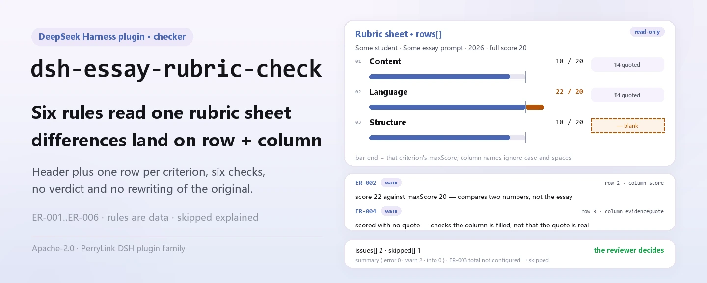

<div align="center">

<picture>
  <source media="(prefers-color-scheme: dark)" srcset="docs/assets/dsh-essay-rubric-check-hero-en-dark.webp">
  
</picture>

# dsh-essay-rubric-check

**Convierte una hoja de rúbrica de ensayo en una lista punto por punto de lo que no cuadra: qué fila, qué columna, qué falta y cómo corregirlo.**

Una herramienta de verificación de hojas de puntuación para investigadores didácticos, profesores de lengua china y equipos de corrección: lee la cabecera del estudiante más una fila por criterio, comprueba la completitud, la aritmética, el rastro de evidencia, la unicidad de los números de criterio y la atribución de la hoja, y enumera las diferencias sin decidir nada por el revisor.

[Instalar](#instalación-en-tres-pasos) · [Configuración](#configuración) · [FAQ](#faq) · [简体中文](README.md) · [English](README.en.md) · [Español](README.es.md) · [Português](README.pt.md) · [हिन्दी](README.hi.md)

[](LICENSE)
[](#compatibilidad)
[](https://www.npmjs.com/package/dsh-essay-rubric-check)
[](https://github.com/PerryLink/dsh-essay-rubric-check/actions/workflows/ci.yml)
[](#compatibilidad)

[](https://github.com/PerryLink/dsh-essay-rubric-check/stargazers)
[](https://www.npmjs.com/package/dsh-essay-rubric-check)
[](https://dshfind.com/plugins/PerryLink/dsh-essay-rubric-check?ref=badge)
[](https://securityscorecards.dev/viewer/?uri=github.com/PerryLink/dsh-essay-rubric-check)
[](https://dsh.market/)
[](https://gitee.com/perrylink/dsh-essay-rubric-check)

```sh
dsh plugin --profile <name> add dsh-essay-rubric-check
```

</div>

<sub>Plugin de la comunidad, no afiliado a DeepSeek. Repositorio canónico: <https://github.com/PerryLink/dsh-essay-rubric-check> (Gitee es un espejo).</sub>

## Qué es

`dsh-essay-rubric-check` lee una **hoja de rúbrica de ensayo** —la cabecera del estudiante más una fila por criterio— y comprueba la completitud, la aritmética y el rastro de evidencia de esa propia hoja: que cada criterio registre un nombre o una descripción de nivel, que una puntuación no supere el máximo de ese criterio, que las puntuaciones de los criterios sumen la puntuación de la rúbrica, que todo criterio puntuado deje una cita textual, que los números de criterio no se repitan y que la hoja declare su estudiante y su versión de rúbrica. Solo enumera las diferencias que puede señalar en el material; no decide si el ensayo está bien escrito, si la puntuación es correcta ni si el comentario es adecuado.

Registra una herramienta visible para el modelo, `essay_rubric_check`: el material es JSON o YAML (`file` y `material` son mutuamente excluyentes) y la salida es un informe `markdown` más `reportJson` y los recuentos de `summary`. Toda comprobación que no pudo ejecutarse aparece en `skipped` con su motivo; nunca se da por buena en silencio.

Pensada para investigadores didácticos, profesores de lengua china y equipos de corrección: exporta la hoja a JSON/YAML para verificar por lotes; el archivo original es de solo lectura y nunca se modifica.

<picture>
  <source media="(prefers-color-scheme: dark)" srcset="docs/assets/dsh-essay-rubric-check-flow-v5-dark.svg">
  
</picture>

## Instalación en tres pasos

1. **Instala** (elige un canal):

   ```sh
   # canal git (último main; equivalente a git+https://github.com/PerryLink/dsh-essay-rubric-check.git)
   dsh plugin --profile web add github:PerryLink/dsh-essay-rubric-check
   # canal npm (versiones publicadas)
   dsh plugin --profile web add dsh-essay-rubric-check
   # canal tarball: pnpm pack en este repo (prepare construye lib/ primero)
   dsh plugin --profile web add ./dsh-essay-rubric-check-<version>.tgz
   ```

2. **Configuración mínima** (los valores por defecto funcionan; configura solo para desactivar reglas, ejecutar un subconjunto o apuntar a otro paquete de reglas):

   ```yaml
   - insert:
       - id: dsh-essay-rubric-check
         name: dsh-essay-rubric-check
         config:
           disabledRules: []
           onlyRules: []
           timeoutMs: 120000
   ```

   `cordis.patch.yml` solo inserta esta fila; todos los parámetros ajustables viven en el esquema Schemastery de `src/config.ts`.

3. **Verifica que se monta**:

   ```sh
   dsh --profile web --dump-config | grep -A2 'id: dsh-essay-rubric-check'
   node samples/quickstart/run.mjs
   ```

   Se espera que el ejemplo `ER-001-unsafe.json` produzca 1 warn y 1 skipped (`ER-003` no está configurada; véase FAQ).

**Desinstalar**: `dsh plugin --profile web remove dsh-essay-rubric-check` (o elimina la fila del patch del perfil).

<details>
<summary>Usarlo desde WorkBuddy / Coze</summary>

Busca «Teaching and Review Suite» en WorkBuddy / Coze (esta comprobación es una de sus partes; disponibilidad según catálogo). La instalación por línea de comandos sigue siendo la de arriba.

</details>

## Capacidades clave

La herramienta se llama `essay_rubric_check`. Lee una hoja con forma de «cabecera del estudiante + una fila por criterio», aplica un paquete de reglas versionado y devuelve un informe revisable línea por línea.

- **Seis reglas integradas** — completitud, techo de puntuación, total, evidencia de cita, unicidad de números y atribución de cabecera; todas en `warn`.
- **El paquete de reglas es datos** — las reglas están en `rules/essay-rubric-check.yaml`; sustituir el archivo cambia el conjunto de reglas sin tocar TypeScript. El paquete se valida al cargar, no se confía en él.
- **Sin omisiones silenciosas** — `skipped` nombra cada regla que no pudo ejecutarse y su motivo; `summary` da los recuentos error / warn / info, de modo que una lista vacía de problemas no puede leerse como «todo correcto».
- **Solo lectura, local, sin llamada al modelo** — análisis y aritmética puros; sin red, sin modificar el original y sin invocar al modelo.
- **Dos formas de entrada** — `file` (ruta absoluta JSON/YAML) o `material` (texto en línea); `args.only` limita la ejecución a las reglas indicadas.

### Reglas

| Regla | Qué comprueba | Gravedad | Tipo de base |
|---|---|---|---|
| `ER-001` | el criterio y su descripción de nivel están registrados | warn | principle |
| `ER-002` | una puntuación no supera el máximo del criterio | warn | principle |
| `ER-003` | los criterios suman la puntuación de la rúbrica (sin configurar por defecto) | warn | principle |
| `ER-004` | un criterio puntuado deja una cita textual | warn | principle |
| `ER-005` | los números de criterio son únicos | warn | principle |
| `ER-006` | la hoja declara su estudiante y su versión de rúbrica | warn | principle |

### Ejemplos

**Herramienta** `essay_rubric_check`

**Entrada**

~~~json
{"rows":[{"序号":"1","评分项":"","维度":"内容","等级描述":"","得分":"18", ...}]}
~~~

**Salida**

~~~json
{
  "id": "dsh-essay-rubric-check.ER-001.de09b5a6",
  "ruleId": "ER-001",
  "severity": "warn",
  "locator": {
    "row": 1,
    "field": "criterion"
  },
  "found": "第 1 行 criterion、levelDesc 都为空",
  "expected": "criterion、levelDesc 至少应填写一项",
  "fix": "补填评分项与等级描述；本条只核对是否填写，不判断量表是否合理"
}
~~~

*Observado en `dsh-essay-rubric-check/tests/fixtures/ER-001/ER-001-unsafe.json; dsh-essay-rubric-check/tests/fixtures/ER-001/cases.json; dsh-essay-rubric-check/rules/essay-rubric-check.yaml; dsh-essay-rubric-check/tests/index.test.ts`*

| Usted pregunta | Qué responde |
|---|---|
| Un criterio lleva una puntuación superior al máximo escrito para él. ¿Qué ocurre? | `ER-002` compara `score` con `maxScore` e informa de la fila en la que la puntuación supera el máximo. Solo compara esos dos números y no juzga si esa puntuación corresponde a este ensayo: el plugin nunca ve el texto. |
| ¿Por qué la regla del total aparece en `skipped` en lugar de informar de algo? | `ER-003` se entrega deliberadamente sin configurar. Su expresión apunta a un campo de relleno, `dimensionRef`, así que no suma nada y la regla se informa a sí misma en `skipped`. Indique los campos de dimensión de su propia rúbrica en `expression.fields`, o cambie a sumar las filas de detalle contra el total de la cabecera, y se ejecuta. El plugin no supone cómo se compone su total. |
| El mismo número de criterio aparece en dos filas de la rúbrica. | `ER-005` informa de un valor repetido en `criterionNo`, porque un duplicado hace que un criterio parezca registrado dos veces. Al comparar ignora los espacios en blanco. Puntuar una dimensión por bandas es una forma legítima: dé a cada banda su propio número, o desactive la regla. |
| Un criterio tiene puntuación pero ninguna cita textual del escrito. | `ER-004` informa de esa fila: solo cuando `score` está relleno exige `evidenceQuote`. Comprueba que la celda de localización esté rellena, no que la cita provenga realmente de ese ensayo: una cita inventada pero verosímil pasa este plugin. |
| Están vacíos tanto el nombre del criterio como su descripción de nivel. | `ER-001` exige al menos uno de `criterion` y `levelDesc` en una fila e informa de la fila en la que ambos están vacíos. Solo comprueba que uno de los dos esté relleno y no juzga si los criterios de la rúbrica son sólidos ni si sus descripciones de nivel son adecuadas. |
| La cabecera de la hoja no dice a qué estudiante pertenece ni qué versión de rúbrica se usó. | `ER-006` exige que la cabecera declare `student` y `rubricVersion`, e informa del que falte, porque las puntuaciones no se pueden atribuir y las versiones de rúbrica no son directamente comparables. Ambos son campos de cabecera, comprobados una vez para la hoja y no fila por fila. Si su formulario también registra en la cabecera una fecha de corrección, añada `markedAt` a los `fields` de la regla. |

### Formato del material

JSON o YAML. Los nombres de columna se comparan sin distinguir mayúsculas y ignorando espacios, guiones bajos y guiones; se conservan los nombres de columna de la propia hoja, de modo que un hallazgo nombra la columna que leyó.

```yaml
student: 某某考生
assignment: 某某作文题
rubricName: 某某作文评分量表
rubricVersion: 2026 版
totalScore: '18'
fullScore: '20'
markedAt: 2026-04-10
rows:
  - { 序号: '1', 评分项: 内容, 分值: '20',
      等级描述: 切合题意，中心突出，内容充实，感情真挚（一类卷 17—20 分）,
      得分: '18', 原文定位: '"他把那盏灯擦了三遍，直到玻璃上映出自己的影子。"',
      所在段落: 第 4 段, 评语: 以细节支撑情感，内容充实，符合一类卷标准。, 评分人: 王老师 }
```

### Normas que sigue

| Documento | Número | Reglas que lo citan |
|---|---|---|
| Chinese Language Curriculum Standards for Senior Secondary School | Versión vigente y número de artículo no verificados en esta pasada | ER-001, ER-002, ER-003, ER-005, ER-006 |
| National Unified Examination for Admissions to General Universities and Colleges — marking work regulations | Versión vigente y número de artículo no verificados en esta pasada | ER-004 |

**Boundary:** esta herramienta comprueba una **hoja de rúbrica de ensayo** en su aritmética y su evidencia: que cada criterio se nombre a sí mismo y a su descripción de nivel, que una puntuación no supere el máximo del criterio, que los criterios sumen la puntuación de la rúbrica, que **un criterio puntuado deje una cita textual del escrito**, que los números de criterio sean únicos y que la hoja declare su estudiante y su versión de rúbrica. **No** decide si el ensayo está bien escrito, si la puntuación es correcta, si el comentario es adecuado ni si una observación debe revisarse.

> ### ⚠️ Lea esto antes de fiarse de una cita del informe
>
> **El estado de `excerpt` es por regla, no uniforme.** Algunas reglas citan el artículo literalmente (`kind: direct`), otras se derivan del principio de los artículos citados (`kind: derived-from-principle`, tope `warn`) y otras usan umbrales que configura su institución (`kind: institutional-configuration`, tope `info`). El paquete nunca parafrasea una cita: cuando el texto no se obtuvo, el campo `excerpt` lo dice y el razonamiento vive en `note`; una prueba afirma que ninguna regla reclama una cita que no tiene. **Para cualquier regla aún marcada como no obtenida, sustituya el `excerpt` por el artículo real y eleve `kind` a `direct` cuando tenga el texto.**
>
> La conclusión es del revisor: esta herramienta enumera diferencias que puede señalar en el material y no decide hechos ni cumplimiento.

Los datos de las reglas están separados del código: cada regla lleva documento, número, artículo en la numeración propia de la fuente, extracto literal y URL de origen. El cargador impone que el extracto sea una cita real de al menos ocho caracteres; las comprobaciones derivadas solo de un principio general (`kind: derived-from-principle`) tienen tope `warn`, y las que usan umbrales de la institución (`kind: institutional-configuration`) tienen tope `info`. Los límites verificados y las conclusiones deliberadamente **no** afirmadas están en `rules/evidence/`.

## Configuración

Todos los parámetros ajustables viven en el esquema Schemastery de `src/config.ts`, por lo que se cambian desde la configuración del perfil sin tocar el código; los umbrales por regla están en el paquete de reglas bajo `rules/`.

| Clave | Tipo | Predeterminado | Descripción |
|---|---|---|---|
| `rulesFile` | string | `rules/essay-rubric-check.yaml` | Ruta del paquete de reglas, relativa a la raíz del paquete |
| `disabledRules` | string[] | `[]` | Ids de reglas que se dejan de ejecutar; cada una aparece en `skipped` |
| `onlyRules` | string[] | `[]` | Ejecutar solo estas reglas; vacío ejecuta todas |
| `skipNotes` | string | `""` | Nota añadida a cada motivo de `skipped` |
| `timeoutMs` | number | `120000` | Presupuesto de tiempo de espera cooperativo de la herramienta |

<details>
<summary>Parámetros por regla (editar el paquete de reglas, no Config)</summary>

- `ER-003` `expression` — **debe configurarse antes de que haga algo.** O bien nombre los campos de dimensión
  (`{ "op": "sum", "fields": ["contentScore", "languageScore"] }`), o bien sume las líneas de detalle contra el
  total de la cabecera; la expresión de fábrica apunta a un campo de relleno y no calcula nada.
- `ER-002` `leftField` / `rightField` / `relation` — la comparación, `score <= maxScore` por defecto.
- `ER-004` `conditionField` / `requiredFields` — qué activa la exigencia de cita.

</details>

Ejemplo de sobrescritura del patch del perfil:

```yaml
- insert:
    - id: dsh-essay-rubric-check
      name: dsh-essay-rubric-check
      config:
        onlyRules: [ER-001, ER-002, ER-004]
        skipNotes: esta pasada solo comprueba completitud, aritmética y evidencia
```

## FAQ

<details>
<summary>¿Se sube el material? ¿Dónde se guardan los datos?</summary>

No. El plugin lee el contenido del documento que se pasa a su herramienta y no hace peticiones de red, no incluye telemetría ni informes en segundo plano y no escribe nada fuera del resultado de la herramienta y del almacenamiento de sesión/registro del propio host DSH. El host controla ese almacenamiento y su retención; este paquete no añade una segunda copia. Desinstalar el paquete elimina su código; no borra los registros de sesión del host ni los documentos que ya haya creado.

</details>

<details>
<summary>¿Por qué `ER-003` está en `skipped`? ¿Se está omitiendo el total?</summary>

Está deliberadamente sin configurar, no se omite. «Qué filas suman el total» depende de cómo su rúbrica divida sus dimensiones (contenido / estructura / lengua / caligrafía, u otra), así que la expresión de fábrica apunta a un campo de relleno, `dimensionRef`, y **no calcula nada**; la regla se informa a sí misma en `skipped` en lugar de adivinar. Nombre sus campos de dimensión en `expression.fields`, o cambie a sumar las líneas contra el total de la cabecera, y la regla se ejecuta. **El plugin no supone cómo se compone su total.**

</details>

<details>
<summary>¿Puede pasar una cita inventada?</summary>

Sí. `ER-004` solo comprueba que la celda de localización esté rellena cuando hay puntuación; nunca comprueba que la cita aparezca en el ensayo —comparar exige el ensayo, que el plugin no ve—. Una cita inventada pero verosímil pasa esta regla.

</details>

<details>
<summary>¿Cuál es el coste de rendimiento?</summary>

Analizar una hoja y seis comprobaciones literales es aritmética local: sin peticiones de red y sin llamadas al modelo. `timeoutMs` es solo el presupuesto cooperativo de tiempo de espera, 120 segundos por defecto; el material normal queda muy por debajo.

</details>

<details>
<summary>¿Chocará con otros plugins por nombres de herramienta o servicios?</summary>

No. Registra exactamente una herramienta, `essay_rubric_check`, y no aporta service key, comando, slot de cliente, ruta HTTP ni mutación global; el registro se elimina con el plugin. Véase «Interoperabilidad con otros plugins DSH».

</details>

## Solución de problemas

- **`ER-003` se informa como skipped.** Su expresión sigue apuntando al campo de relleno. Configure los campos de dimensión o la forma de suma por líneas; el plugin no supondrá cómo se compone su total.
- **`ER-004` dejó pasar una cita inventada.** Solo comprueba que la cita *exista*, nunca que aparezca en el ensayo; comparar exige el ensayo, que el plugin no ve.
- **`ER-004` se dispara en un criterio que no necesita cita.** Desactive la regla o separe ese criterio en una rúbrica propia.
- **`ER-002` se dispara con una puntuación igual al máximo.** La igualdad está permitida; un hallazgo significa que la puntuación es mayor.
- **`ER-005` se dispara en dos filas de una misma dimensión.** Las filas por bandas dentro de una dimensión son legítimas: numérelas de forma distinta.
- **El plugin se instala pero la herramienta no aparece.** Compruebe que `main` resuelve a `lib/index.mjs` y que `pnpm run build` lo generó; un `main` incorrecto hace que el cargador omita la entrada en silencio.
- **`dsh plugin add` rechaza el paquete por incompatibilidad.** El rango de peers cubre `0.1.x` y `0.2.x`; si su runtime queda fuera, conceda una exención explícita: `dsh plugin --profile <name> allow-version dsh-essay-rubric-check@0.2.10 --dsh-version <runtime> --accept-risk`.
- **`check` informa `manifest-peers` como fallo.** El verificador estático compara con un rango de peers codificado que es anterior a la línea 0.2. El runtime aplica la compatibilidad al instalar, así que el rango declarado es el correcto; es un problema conocido de `dsh-plugin-dev`.

## Límites de seguridad y limitaciones conocidas

- **Ve la hoja de rúbrica, nunca el ensayo.** `ER-002` solo compara dos números y no puede juzgar si una puntuación corresponde al escrito; `ER-004` solo comprueba que la celda de localización esté rellena y no puede verificar la cita. Estos son los límites de capacidad más importantes del plugin.
- **Sin veredicto de cumplimiento, sin imputación de responsabilidad, sin sustituir al revisor.** El informe enumera diferencias que puede señalar en el material y siempre lleva el descargo; la conclusión pertenece a quien corrige y a la gestión de calidad de la corrección.
- **El estado de las citas es por regla y la mayoría de los artículos no se obtuvo.** El paquete declara «el texto del artículo no se obtuvo» en cada `excerpt` y limita la gravedad según la evidencia: `derived-from-principle` en `warn`, `institutional-configuration` en `info`, y solo `direct` puede llevar `error`. Una prueba afirma que ninguna regla reclama una cita que no tiene; cuando tenga el artículo real, sustituya el `excerpt` y eleve `kind` a `direct`.
- **`ER-003` no calcula ningún total por defecto.** La expresión de fábrica apunta al campo de relleno `dimensionRef`; sin configuración no hay comprobación del total, y la regla lo dice en `skipped` en lugar de pasar en silencio.
- **Una lista vacía de problemas nunca significa «no hay nada mal».** Toda comprobación que no pudo ejecutarse aparece en `skipped` con su motivo; una regla cuya lista de requisitos no está configurada se informa en `skipped` en vez de pasar.
- **Validación al cargar.** Un paquete cuyo extracto tenga menos de ocho caracteres o cuya gravedad exceda su tipo de base falla al cargar en lugar de producir un informe con apariencia de solidez.
- **Solo lectura y local.** Lee el archivo de entrada y nunca reescribe el original; no hay peticiones de red, telemetría ni llamadas al modelo.

## Interoperabilidad con otros plugins DSH

- **Una sola herramienta.** `essay_rubric_check` se registra mediante el servicio estándar `tools` (`inject: ['tools']`); el plugin no aporta service key, comando, slot de cliente ni ruta HTTP, y no modifica ningún objeto global.
- **El registro es un effect.** El registro devuelve un disposer, así que descargar o recargar en caliente el plugin elimina la entrada de la herramienta sin residuos.
- **ESM puro, sin código nativo.** No incorpora módulos nativos, no lanza subprocesos y no abre conexiones de red, por lo que puede compartir perfil con cualquier otro plugin DSH.
- **La E/S se queda en la superficie estándar de herramientas.** Solo consume el `file` / `material` del llamador y devuelve el informe como resultado de la herramienta; no escucha eventos de sesión ni compite por cadenas de eventos.

## Compatibilidad

| Superficie | Estado |
|---|---|
| Harness | Rango de peers `>=0.1.2-rc.1 <0.2.0 \|\| >=0.2.0-0 <0.3.0` — verificado para aceptar tanto `0.2.0-rc.2` como `0.2.1-rc.2`. **`engines.dsh` se declara como `>=0.2.1-0 <0.3.0`** y el host lo aplica desde 0.2.1 |
| Node | `^22.19.0 \|\| >=24.0.0` |
| Plataformas | Todas (ESM puro; sin código nativo, sin red, sin llamada al modelo) |
| Modo de herramienta | Funciona en `native` y `ptc`; para verificar varias hojas por lotes use `ptc`, así el coste del esquema se paga una vez |

## Ecosistema y calidad

- [Espejo en Gitee](https://gitee.com/perrylink/dsh-essay-rubric-check) (espejo sincronizado; GitHub es la referencia)
- [Página de dshfind](https://dshfind.com/plugins/PerryLink/dsh-essay-rubric-check) (instalaciones y posición)
- [Informe OpenSSF Scorecard](https://securityscorecards.dev/viewer/?uri=github.com/PerryLink/dsh-essay-rubric-check) (impulsado por [.github/workflows/scorecard.yml](.github/workflows/scorecard.yml))
- [DSH Market](https://dsh.market/) (listado)
- [Base de conocimiento del ecosistema](https://perrylink.github.io/dsh-plugin-guide/): guía de desarrollo de plugins · mediciones de selección · criterios de mantenimiento

## Desarrollo

```sh
pnpm install
pnpm run typecheck
pnpm test
pnpm run build
pnpm run verify:self-contained
pnpm run check:lockfile
pnpm run check:readmes
pnpm run check:citations
node ../scripts/sync-shared.mjs dsh-essay-rubric-check
pnpm pack
```

El plugin está **dirigido por datos**: `src/model.ts` declara la forma de la tabla, el kit compartido aporta el lector y el motor de comprobación, y el paquete de reglas declara cada comprobación. `node ../scripts/sync-shared.mjs dsh-essay-rubric-check` copia el kit compartido de `../_shared` a `src/shared/`; vuelva a ejecutarlo tras cada cambio compartido.

`pnpm run check:readmes` mantiene los cinco README con el mismo número de secciones, el mismo comando de instalación y las mismas claves de configuración. Las figuras se generan con [`scripts/gen-readme-assets.py`](scripts/gen-readme-assets.py) (portada en WebP clara y oscura, diagrama de estructura en SVG claro y oscuro) y pueden regenerarse en cualquier momento.

## Familia y agradecimientos

Este proyecto es miembro de la familia de plugins de DeepSeek Harness mantenida por [PerryLink](https://github.com/PerryLink) (todos Apache-2.0). Si este plugin te ha ayudado, **dale una estrella**: no desbloquea nada, pero ayuda a que la siguiente persona lo encuentre.

- [@PerryLink](https://github.com/PerryLink) — creador y mantenedor: paquete de reglas, motor de comprobación, documentación en cinco idiomas y puertas de CI.

<details>
<summary>Mostrar todos los plugins</summary>

| Plugin | Estado |
|---|---|
| **[dsh-aqua-input-check](https://github.com/PerryLink/dsh-aqua-input-check)** |  |
| **[dsh-archive-check](https://github.com/PerryLink/dsh-archive-check)** |  |
| **[dsh-auto-review](https://github.com/PerryLink/dsh-auto-review)** |  |
| **[dsh-autotier](https://github.com/PerryLink/dsh-autotier)** | 🧊 CONGELADO — ver el README del repo |
| **[dsh-bid-ca-precheck](https://github.com/PerryLink/dsh-bid-ca-precheck)** |  |
| **[dsh-bid-qual-check](https://github.com/PerryLink/dsh-bid-qual-check)** |  |
| **[dsh-cert-mcp](https://github.com/PerryLink/dsh-cert-mcp)** | 🧊 CONGELADO — ver el README del repo |
| **[dsh-checkpoint-rewind](https://github.com/PerryLink/dsh-checkpoint-rewind)** |  |
| **[dsh-click](https://github.com/PerryLink/dsh-click)** |  |
| **[dsh-composer-history](https://github.com/PerryLink/dsh-composer-history)** |  |
| **[dsh-contract-stance](https://github.com/PerryLink/dsh-contract-stance)** |  |
| **[dsh-customs-doc-check](https://github.com/PerryLink/dsh-customs-doc-check)** |  |
| **[dsh-data-quality](https://github.com/PerryLink/dsh-data-quality)** | 🧊 CONGELADO — ver el README del repo |
| **[dsh-demurrage-ledger](https://github.com/PerryLink/dsh-demurrage-ledger)** |  |
| **[dsh-doublecheck](https://github.com/PerryLink/dsh-doublecheck)** |  |
| **[dsh-drill-script-check](https://github.com/PerryLink/dsh-drill-script-check)** |  |
| **[dsh-eia-guide-check](https://github.com/PerryLink/dsh-eia-guide-check)** |  |
| **[dsh-emergency-plan](https://github.com/PerryLink/dsh-emergency-plan)** |  |
| **[dsh-essay-rubric-check](https://github.com/PerryLink/dsh-essay-rubric-check)** |  |
| **[dsh-evidence-check](https://github.com/PerryLink/dsh-evidence-check)** |  |
| **[dsh-export-ctl-check](https://github.com/PerryLink/dsh-export-ctl-check)** |  |
| **[dsh-fast](https://github.com/PerryLink/dsh-fast)** |  |
| **[dsh-fmea-table-check](https://github.com/PerryLink/dsh-fmea-table-check)** |  |
| **[dsh-forecast-penalty](https://github.com/PerryLink/dsh-forecast-penalty)** |  |
| **[dsh-fund-research](https://github.com/PerryLink/dsh-fund-research)** |  |
| **[dsh-github](https://github.com/PerryLink/dsh-github)** |  |
| **[dsh-gongwen-flow-check](https://github.com/PerryLink/dsh-gongwen-flow-check)** |  |
| **[dsh-gongwen-word-check](https://github.com/PerryLink/dsh-gongwen-word-check)** |  |
| **[dsh-guard-plan-qc](https://github.com/PerryLink/dsh-guard-plan-qc)** |  |
| **[dsh-hazchem-check](https://github.com/PerryLink/dsh-hazchem-check)** |  |
| **[dsh-hazplan-check](https://github.com/PerryLink/dsh-hazplan-check)** |  |
| **[dsh-hidden-risk-map](https://github.com/PerryLink/dsh-hidden-risk-map)** |  |
| **[dsh-hs-classify](https://github.com/PerryLink/dsh-hs-classify)** |  |
| **[dsh-icd-rule-check](https://github.com/PerryLink/dsh-icd-rule-check)** |  |
| **[dsh-industry-research](https://github.com/PerryLink/dsh-industry-research)** |  |
| **[dsh-lawcite-adapter](https://github.com/PerryLink/dsh-lawcite-adapter)** |  |
| **[dsh-laya](https://github.com/PerryLink/dsh-laya)** |  |
| **[dsh-lc-doc-check](https://github.com/PerryLink/dsh-lc-doc-check)** |  |
| **[dsh-learning-gap-check](https://github.com/PerryLink/dsh-learning-gap-check)** |  |
| **[dsh-library](https://github.com/PerryLink/dsh-library)** |  |
| **[dsh-local-ai](https://github.com/PerryLink/dsh-local-ai)** |  |
| **[dsh-lsp-actions](https://github.com/PerryLink/dsh-lsp-actions)** |  |
| **[dsh-mask](https://github.com/PerryLink/dsh-mask)** |  |
| **[dsh-mcp-panel](https://github.com/PerryLink/dsh-mcp-panel)** |  |
| **[dsh-medrec-qc](https://github.com/PerryLink/dsh-medrec-qc)** |  |
| **[dsh-memento](https://github.com/PerryLink/dsh-memento)** | 🧊 CONGELADO — ver el README del repo |
| **[dsh-nsfc-form-check](https://github.com/PerryLink/dsh-nsfc-form-check)** |  |
| **[dsh-nurse-record-check](https://github.com/PerryLink/dsh-nurse-record-check)** |  |
| **[dsh-observe](https://github.com/PerryLink/dsh-observe)** |  |
| **[dsh-origin-rvc-check](https://github.com/PerryLink/dsh-origin-rvc-check)** |  |
| **[dsh-ota-review-check](https://github.com/PerryLink/dsh-ota-review-check)** |  |
| **[dsh-output-styles](https://github.com/PerryLink/dsh-output-styles)** |  |
| **[dsh-paper-doc-adapter](https://github.com/PerryLink/dsh-paper-doc-adapter)** |  |
| **[dsh-permission-rules](https://github.com/PerryLink/dsh-permission-rules)** |  |
| **[dsh-permit-report-check](https://github.com/PerryLink/dsh-permit-report-check)** |  |
| **[dsh-pipeline-check](https://github.com/PerryLink/dsh-pipeline-check)** |  |
| **[dsh-pleading-draft](https://github.com/PerryLink/dsh-pleading-draft)** |  |
| **[dsh-plugin-doctor](https://github.com/PerryLink/dsh-plugin-doctor)** | 🚫 RETIRADO (repo archivado) |
| **[dsh-plugin-guide](https://github.com/PerryLink/dsh-plugin-guide)** |  |
| **[dsh-plugin-kit](https://github.com/PerryLink/dsh-plugin-kit)** | 🚫 RETIRADO (repo archivado) |
| **[dsh-plugin-upgrade](https://github.com/PerryLink/dsh-plugin-upgrade)** | 🚫 RETIRADO (repo archivado) |
| **[dsh-policy-brief-draft](https://github.com/PerryLink/dsh-policy-brief-draft)** |  |
| **[dsh-power-loss-split](https://github.com/PerryLink/dsh-power-loss-split)** |  |
| **[dsh-power-ticket-check](https://github.com/PerryLink/dsh-power-ticket-check)** |  |
| **[dsh-ppap-check](https://github.com/PerryLink/dsh-ppap-check)** |  |
| **[dsh-protest-deadline](https://github.com/PerryLink/dsh-protest-deadline)** |  |
| **[dsh-railway-window](https://github.com/PerryLink/dsh-railway-window)** |  |
| **[dsh-repair-order-qc](https://github.com/PerryLink/dsh-repair-order-qc)** |  |
| **[dsh-research-report](https://github.com/PerryLink/dsh-research-report)** |  |
| **[dsh-review-reply-check](https://github.com/PerryLink/dsh-review-reply-check)** |  |
| **[dsh-rulefile-check](https://github.com/PerryLink/dsh-rulefile-check)** |  |
| **[dsh-safety-brief-check](https://github.com/PerryLink/dsh-safety-brief-check)** |  |
| **[dsh-score](https://github.com/PerryLink/dsh-score)** | 🧊 CONGELADO — ver el README del repo |
| **[dsh-session-sync](https://github.com/PerryLink/dsh-session-sync)** |  |
| **[dsh-site-log-check](https://github.com/PerryLink/dsh-site-log-check)** |  |
| **[dsh-skill-pack-security](https://github.com/PerryLink/dsh-skill-pack-security)** |  |
| **[dsh-soe-decision-check](https://github.com/PerryLink/dsh-soe-decision-check)** |  |
| **[dsh-soilwater-check](https://github.com/PerryLink/dsh-soilwater-check)** |  |
| **[dsh-sop-sync-check](https://github.com/PerryLink/dsh-sop-sync-check)** |  |
| **[dsh-spc-gbt-adapter](https://github.com/PerryLink/dsh-spc-gbt-adapter)** |  |
| **[dsh-talk](https://github.com/PerryLink/dsh-talk)** |  |
| **[dsh-tender-extract](https://github.com/PerryLink/dsh-tender-extract)** |  |
| **[dsh-tender-matrix](https://github.com/PerryLink/dsh-tender-matrix)** |  |
| **[dsh-test-drive](https://github.com/PerryLink/dsh-test-drive)** |  |
| **[dsh-ticktick](https://github.com/PerryLink/dsh-ticktick)** | 🚫 RETIRADO (repo archivado) |
| **[dsh-translate](https://github.com/PerryLink/dsh-translate)** |  |
| **[dsh-warranty-calc](https://github.com/PerryLink/dsh-warranty-calc)** |  |
| **[dsh-budget](https://github.com/PerryLink/dsh-budget)** | 🧊 CONGELADO — ver el README del repo |
| **[dsh-claude-move](https://github.com/PerryLink/dsh-claude-move)** | 🧊 CONGELADO — ver el README del repo |
| **[dsh-defend](https://github.com/PerryLink/dsh-defend)** | 🧊 CONGELADO — ver el README del repo |
| **[dsh-draw](https://github.com/PerryLink/dsh-draw)** | 🧊 CONGELADO — ver el README del repo |
| **[dsh-reach](https://github.com/PerryLink/dsh-reach)** | 🧊 CONGELADO — ver el README del repo |
| **[dsh-background-agents](https://github.com/PerryLink/dsh-background-agents)** | 🚫 RETIRADO (repo archivado) |
| **[dsh-session-pin](https://github.com/PerryLink/dsh-session-pin)** | 🚫 RETIRADO (repo archivado) |
| **[dsh-team-rooms](https://github.com/PerryLink/dsh-team-rooms)** | 🚫 RETIRADO (repo archivado) |

</details>

## Licencia

[LICENSE](LICENSE) (Apache License 2.0) © 2026 dsh-essay-rubric-check contributors

<p align="center"><sub>Apache-2.0 · Plugin de la comunidad, no afiliado a DeepSeek.</sub></p>
