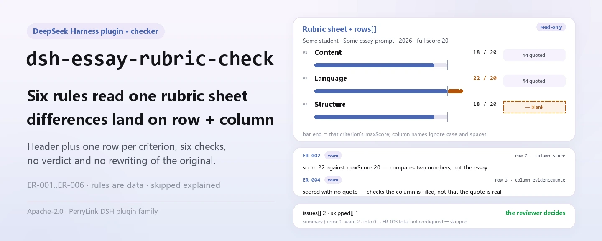

<div align="center">

<picture>
  <source media="(prefers-color-scheme: dark)" srcset="docs/assets/dsh-essay-rubric-check-hero-en-dark.webp">
  
</picture>

# dsh-essay-rubric-check

**निबंध की रूब्रिक शीट की हर असंगति की सूची बनाएँ — कौन-सी पंक्ति, कौन-सा खाना, क्या छूटा और कैसे सुधारें।**

शिक्षण-शोधकर्ताओं, चीनी भाषा के शिक्षकों और जाँच दलों के लिए रूब्रिक शीट जाँच उपकरण: छात्र-हेडर और प्रति-कसौटी एक पंक्ति पढ़कर यह पूर्णता, अंकगणित, उद्धरण-प्रमाण, कसौटी-क्रमांक की विशिष्टता और शीट का स्वामित्व जाँचता है, और समीक्षक की जगह कोई निर्णय लिए बिना केवल अंतर सूचीबद्ध करता है।

[इंस्टॉल](#तीन-चरणों-में-शुरुआत) · [कॉन्फ़िगरेशन](#कॉन्फ़िगरेशन) · [FAQ](#faq) · [简体中文](README.md) · [English](README.en.md) · [Español](README.es.md) · [Português](README.pt.md) · [हिन्दी](README.hi.md)

[](LICENSE)
[](#संगतता)
[](https://www.npmjs.com/package/dsh-essay-rubric-check)
[](https://github.com/PerryLink/dsh-essay-rubric-check/actions/workflows/ci.yml)
[](#संगतता)

[](https://github.com/PerryLink/dsh-essay-rubric-check/stargazers)
[](https://www.npmjs.com/package/dsh-essay-rubric-check)
[](https://dshfind.com/plugins/PerryLink/dsh-essay-rubric-check?ref=badge)
[](https://securityscorecards.dev/viewer/?uri=github.com/PerryLink/dsh-essay-rubric-check)
[](https://dsh.market/)
[](https://gitee.com/perrylink/dsh-essay-rubric-check)

```sh
dsh plugin --profile <name> add dsh-essay-rubric-check
```

</div>

<sub>सामुदायिक प्लगइन, DeepSeek से असंबद्ध। कैनोनिकल रिपॉज़िटरी: <https://github.com/PerryLink/dsh-essay-rubric-check> (Gitee एक मिरर है)।</sub>

## यह क्या है

`dsh-essay-rubric-check` एक **निबंध रूब्रिक शीट** पढ़ता है — छात्र-हेडर और प्रति-कसौटी एक पंक्ति — और उसी शीट की पूर्णता, अंकगणित और प्रमाण-श्रृंखला जाँचता है: हर कसौटी का नाम या स्तर-विवरण दर्ज है या नहीं, कोई अंक उस कसौटी के अधिकतम से अधिक नहीं है या नहीं, कसौटी-अंकों का योग रूब्रिक के कुल अंक के बराबर है या नहीं, हर अंकित कसौटी ने लेख से उद्धृत अंश छोड़ा है या नहीं, कसौटी-क्रमांक अद्वितीय हैं या नहीं, और शीट में छात्र तथा रूब्रिक-संस्करण घोषित हैं या नहीं। यह केवल वे अंतर सूचीबद्ध करता है जिन्हें सामग्री में पंक्ति-दर-पंक्ति इंगित किया जा सके; यह नहीं तय करता कि निबंध अच्छा है, अंक सही है या टिप्पणी उपयुक्त है।

यह मॉडल के लिए दृश्य एक टूल `essay_rubric_check` पंजीकृत करता है: सामग्री JSON या YAML है (`file` और `material` में से एक), और आउटपुट `markdown` रिपोर्ट तथा `reportJson` और `summary` गणनाएँ हैं। जो जाँच नहीं चल सकीं वे कारण सहित `skipped` में दर्ज होती हैं; उन्हें चुपचाप "कुछ गड़बड़ नहीं" नहीं माना जाता।

शिक्षण-शोधकर्ताओं, चीनी भाषा के शिक्षकों और जाँच दलों के लिए: बैच जाँच के लिए शीट को JSON/YAML में निर्यात करें; मूल फ़ाइल केवल-पढ़ने योग्य है और कभी बदली नहीं जाती।

<picture>
  <source media="(prefers-color-scheme: dark)" srcset="docs/assets/dsh-essay-rubric-check-flow-v5-dark.svg">
  
</picture>

## तीन चरणों में शुरुआत

1. **इंस्टॉल करें** (एक चैनल चुनें):

   ```sh
   # git चैनल (नवीनतम main; git+https://github.com/PerryLink/dsh-essay-rubric-check.git के बराबर)
   dsh plugin --profile web add github:PerryLink/dsh-essay-rubric-check
   # npm चैनल (प्रकाशित संस्करण)
   dsh plugin --profile web add dsh-essay-rubric-check
   # tarball चैनल: इस रेपो में pnpm pack (prepare पहले lib/ बनाता है)
   dsh plugin --profile web add ./dsh-essay-rubric-check-<version>.tgz
   ```

2. **न्यूनतम कॉन्फ़िगरेशन** (डिफ़ॉल्ट काम करते हैं; केवल नियम बंद करने, उपसमुच्चय चलाने या दूसरा नियम-पैक चुनने पर लिखें):

   ```yaml
   - insert:
       - id: dsh-essay-rubric-check
         name: dsh-essay-rubric-check
         config:
           disabledRules: []
           onlyRules: []
           timeoutMs: 120000
   ```

   `cordis.patch.yml` केवल यह पंक्ति जोड़ता है; सभी समायोज्य `src/config.ts` की Schemastery स्कीमा में हैं।

3. **जाँचें कि यह माउंट हुआ**:

   ```sh
   dsh --profile web --dump-config | grep -A2 'id: dsh-essay-rubric-check'
   node samples/quickstart/run.mjs
   ```

   `ER-001-unsafe.json` नमूने से 1 warn और 1 skipped की अपेक्षा है (`ER-003` कॉन्फ़िगर नहीं है; FAQ देखें)।

**अनइंस्टॉल**: `dsh plugin --profile web remove dsh-essay-rubric-check` (या प्रोफ़ाइल पैच से पंक्ति हटाएँ)।

<details>
<summary>WorkBuddy / Coze से उपयोग</summary>

WorkBuddy / Coze में "Teaching and Review Suite" खोजें (यह जाँच उसका एक भाग है; उपलब्धता कैटलॉग के अनुसार)। कमांड-लाइन इंस्टॉल ऊपर वाला ही रहता है।

</details>

## मुख्य क्षमताएँ

टूल का नाम `essay_rubric_check` है। यह "छात्र-हेडर + प्रति-कसौटी एक पंक्ति" आकार की शीट पढ़ता है, संस्करणबद्ध नियम-पैक लागू करता है और पंक्ति-दर-पंक्ति समीक्षा योग्य रिपोर्ट लौटाता है।

- **छह अंतर्निहित नियम** — पूर्णता, अंक-सीमा, योग, उद्धरण-प्रमाण, कसौटी-क्रमांक की विशिष्टता और हेडर-स्वामित्व; सभी `warn` पर।
- **नियम-पैक डेटा है** — नियम `rules/essay-rubric-check.yaml` में हैं; फ़ाइल बदलने से TypeScript छुए बिना नियम-समुच्चय बदल जाता है। पैक लोड के समय सत्यापित होता है, मान लिया नहीं जाता।
- **कोई मौन छूट नहीं** — `skipped` हर न चली जाँच का नियम-आईडी और कारण बताता है; `summary` error / warn / info गणनाएँ देता है, इसलिए खाली समस्या-सूची को "सब सही" नहीं पढ़ा जा सकता।
- **केवल-पढ़ने, स्थानीय, मॉडल-कॉल रहित** — शुद्ध पार्सिंग और अंकगणित; कोई नेटवर्क नहीं, मूल फ़ाइल में बदलाव नहीं, मॉडल का आह्वान नहीं।
- **दो इनपुट रूप** — `file` (पूर्ण JSON/YAML पथ) या `material` (इनलाइन पाठ); `args.only` चयनित नियमों तक सीमित करता है।

### नियम

| नियम | क्या जाँचता है | गंभीरता | आधार-प्रकार |
|---|---|---|---|
| `ER-001` | कसौटी और उसका स्तर-विवरण दर्ज है | warn | principle |
| `ER-002` | अंक कसौटी के अधिकतम से अधिक नहीं | warn | principle |
| `ER-003` | कसौटी-अंकों का योग रूब्रिक के कुल अंक के बराबर (डिफ़ॉल्ट रूप से कॉन्फ़िगर नहीं) | warn | principle |
| `ER-004` | अंकित कसौटी उद्धृत अंश छोड़ती है | warn | principle |
| `ER-005` | कसौटी-क्रमांक अद्वितीय हैं | warn | principle |
| `ER-006` | शीट छात्र और रूब्रिक-संस्करण घोषित करती है | warn | principle |

### उदाहरण

**टूल** `essay_rubric_check`

**इनपुट**

~~~json
{"rows":[{"序号":"1","评分项":"","维度":"内容","等级描述":"","得分":"18", ...}]}
~~~

**आउटपुट**

~~~json
{
  "id": "dsh-essay-rubric-check.ER-001.de09b5a6",
  "ruleId": "ER-001",
  "severity": "warn",
  "locator": {
    "row": 1,
    "field": "criterion"
  },
  "found": "第 1 行 criterion、levelDesc 都为空",
  "expected": "criterion、levelDesc 至少应填写一项",
  "fix": "补填评分项与等级描述；本条只核对是否填写，不判断量表是否合理"
}
~~~

*स्रोत `dsh-essay-rubric-check/tests/fixtures/ER-001/ER-001-unsafe.json; dsh-essay-rubric-check/tests/fixtures/ER-001/cases.json; dsh-essay-rubric-check/rules/essay-rubric-check.yaml; dsh-essay-rubric-check/tests/index.test.ts`*

| आपका सवाल | इसका जवाब |
|---|---|
| किसी कसौटी में उसके लिए लिखे अधिकतम से अधिक अंक दर्ज है। क्या होता है? | `ER-002` `score` की तुलना `maxScore` से करता है और जिस पंक्ति में अंक अधिकतम से अधिक है उसे दर्ज करता है। यह केवल उन दोनों संख्याओं की तुलना करता है और यह नहीं आँकता कि वह अंक इस निबंध के अनुरूप है या नहीं: यह प्लगइन निबंध को कभी नहीं देखता। |
| कुल-अंक वाला नियम कुछ बताने के बजाय `skipped` में क्यों आता है? | `ER-003` जानबूझकर बिना कॉन्फ़िगर भेजा गया है। उसका व्यंजक एक प्लेसहोल्डर फ़ील्ड `dimensionRef` की ओर संकेत करता है, इसलिए कुछ भी जोड़ा नहीं जाता और नियम स्वयं को `skipped` में दर्ज करता है। अपने रूब्रिक के आयाम-फ़ील्ड `expression.fields` में लिखें, या विवरण-पंक्तियों का जोड़ हेडर के कुल अंक से मिलाने का तरीका चुनें, तब यह चलता है। यह प्लगइन यह नहीं मान लेता कि आपका कुल अंक किन चीज़ों से बनता है। |
| रूब्रिक की दो पंक्तियों में एक ही कसौटी-क्रमांक है। | `ER-005` `criterionNo` में दोहराया गया मान दर्ज करता है, क्योंकि दोहराव से एक कसौटी दो बार दर्ज दिखती है। तुलना करते समय यह श्वेत-स्थान छोड़ देता है। एक ही आयाम को श्रेणियों में अंकित करना सामान्य है: हर श्रेणी को अलग क्रमांक दें, या इस नियम को बंद कर दें। |
| किसी कसौटी में अंक है, पर लेख से कोई उद्धृत अंश नहीं। | `ER-004` उस पंक्ति को दर्ज करता है: केवल जब `score` भरा हो, तब वह `evidenceQuote` की अपेक्षा करता है। यह देखता है कि स्थान-निर्देश वाला खाना भरा है, यह नहीं कि उद्धरण वास्तव में उसी निबंध से है — मनगढ़ंत पर विश्वसनीय लगता उद्धरण इस प्लगइन से पास हो जाता है। |
| कसौटी का नाम और उसका स्तर-विवरण, दोनों खाली हैं। | `ER-001` एक पंक्ति में `criterion` और `levelDesc` में से कम से कम एक की अपेक्षा करता है और जिस पंक्ति में दोनों खाली हैं उसे दर्ज करता है। यह केवल देखता है कि इनमें से एक भरा है, और यह नहीं आँकता कि रूब्रिक की कसौटियाँ ठोस हैं या उनके स्तर-विवरण उपयुक्त हैं। |
| पत्र के हेडर में न यह लिखा है कि यह किस छात्र का है, न यह कि कौन-सा रूब्रिक संस्करण प्रयुक्त हुआ। | `ER-006` हेडर में `student` और `rubricVersion` दोनों घोषित होने की अपेक्षा करता है और जो छूटा हो उसे दर्ज करता है, क्योंकि अंकों का श्रेय नहीं दिया जा सकता और रूब्रिक संस्करण सीधे तुलनीय नहीं होते। ये दोनों हेडर-फ़ील्ड हैं, जो पूरे पत्र के लिए एक बार जाँचे जाते हैं, पंक्ति-दर-पंक्ति नहीं। यदि आपके प्रपत्र में हेडर में जाँच-तिथि भी दर्ज होती है, तो नियम के `fields` में `markedAt` जोड़ दें। |

### सामग्री का प्रारूप

JSON या YAML। स्तंभ-नाम बड़े/छोटे अक्षर, खाली स्थान, अंडरस्कोर और हाइफ़न की उपेक्षा करते हुए मिलाए जाते हैं; शीट के अपने स्तंभ-नाम सुरक्षित रहते हैं, इसलिए निष्कर्ष उसी स्तंभ का नाम लेता है जिसे उसने पढ़ा।

```yaml
student: 某某考生
assignment: 某某作文题
rubricName: 某某作文评分量表
rubricVersion: 2026 版
totalScore: '18'
fullScore: '20'
markedAt: 2026-04-10
rows:
  - { 序号: '1', 评分项: 内容, 分值: '20',
      等级描述: 切合题意，中心突出，内容充实，感情真挚（一类卷 17—20 分）,
      得分: '18', 原文定位: '"他把那盏灯擦了三遍，直到玻璃上映出自己的影子。"',
      所在段落: 第 4 段, 评语: 以细节支撑情感，内容充实，符合一类卷标准。, 评分人: 王老师 }
```

### किन मानकों पर आधारित है

| दस्तावेज़ | संख्यांक | इन्हें उद्धृत करने वाले नियम |
|---|---|---|
| Chinese Language Curriculum Standards for Senior Secondary School | वर्तमान संस्करण और धारा-संख्या इस पास में सत्यापित नहीं | ER-001, ER-002, ER-003, ER-005, ER-006 |
| National Unified Examination for Admissions to General Universities and Colleges — marking work regulations | वर्तमान संस्करण और धारा-संख्या इस पास में सत्यापित नहीं | ER-004 |

**Boundary:** यह उपकरण एक **निबंध रूब्रिक शीट** का अंकगणित और प्रमाण जाँचता है: हर कसौटी अपना नाम और स्तर-विवरण देती है, कोई अंक कसौटी के अधिकतम से अधिक नहीं है, कसौटी-अंक रूब्रिक का कुल बनाते हैं, **अंकित कसौटी लेख से उद्धृत अंश छोड़ती है**, कसौटी-क्रमांक अद्वितीय हैं, और शीट छात्र तथा रूब्रिक-संस्करण बताती है। यह **नहीं** तय करता कि निबंध अच्छा है, अंक सही है, टिप्पणी उपयुक्त है, या किसी टिप्पणी की समीक्षा होनी चाहिए।

> ### ⚠️ रिपोर्ट के उद्धरण पर भरोसा करने से पहले यह पढ़ें
>
> **`excerpt` की स्थिति प्रति-नियम अलग है, एक-सी नहीं।** कुछ नियम धारा को शब्दशः उद्धृत करते हैं (`kind: direct`), कुछ उद्धृत अनुच्छेदों के सिद्धांत से व्युत्पन्न हैं (`kind: derived-from-principle`, अधिकतम `warn`), और कुछ आपकी संस्था द्वारा कॉन्फ़िगर की गई सीमाएँ लेते हैं (`kind: institutional-configuration`, अधिकतम `info`)। पैक कभी उद्धरण का परावर्तन नहीं करता: जब पाठ नहीं मिला, `excerpt` यह कह देता है और तर्क `note` में रहता है; एक परीक्षण प्रमाणित करता है कि कोई नियम ऐसा उद्धरण नहीं माँगता जो उसके पास न हो। **जो नियम अभी भी 'पाठ नहीं मिला' के रूप में चिह्नित हैं, उनके लिए पाठ मिलने पर `excerpt` को वास्तविक धारा से बदलें और `kind` को `direct` करें।**
>
> निष्कर्ष समीक्षक का है: यह उपकरण सामग्री में पंक्ति-दर-पंक्ति इंगित किए जा सकने वाले अंतर सूचीबद्ध करता है और तथ्य या अनुपालन तय नहीं करता।

नियम-डेटा कोड से अलग है: प्रत्येक नियम में दस्तावेज़, संख्या, स्रोत की अपनी क्रमांकन-प्रणाली के अनुसार धारा, शब्दशः उद्धरण और स्रोत URL होता है। लोडर लागू करता है कि उद्धरण कम से कम आठ अक्षरों का वास्तविक उद्धरण हो; केवल सामान्य सिद्धांत से व्युत्पन्न जाँच (`kind: derived-from-principle`) का अधिकतम `warn` है, और संस्था की सीमाओं पर आधारित जाँच (`kind: institutional-configuration`) का अधिकतम `info` है। सत्यापित सीमाएँ और जान-बूझकर **न** कहे गए निष्कर्ष `rules/evidence/` में दर्ज हैं।

## कॉन्फ़िगरेशन

सभी समायोज्य पैरामीटर `src/config.ts` की Schemastery स्कीमा में हैं, इसलिए प्रोफ़ाइल कॉन्फ़िगरेशन से कोड बदले बिना बदले जा सकते हैं; प्रति-नियम सीमाएँ `rules/` के नियम-पैक में हैं।

| कुंजी | प्रकार | डिफ़ॉल्ट | विवरण |
|---|---|---|---|
| `rulesFile` | string | `rules/essay-rubric-check.yaml` | नियम-पैक का पथ, पैकेज रूट के सापेक्ष |
| `disabledRules` | string[] | `[]` | बंद करने वाले नियम id; प्रत्येक `skipped` में दिखता है |
| `onlyRules` | string[] | `[]` | केवल ये नियम चलाएँ; खाली होने पर सभी नियम चलते हैं |
| `skipNotes` | string | `""` | हर `skipped` कारण के आगे जोड़ी जाने वाली टिप्पणी |
| `timeoutMs` | number | `120000` | उपकरण का सहकारी समय-सीमा बजट |

<details>
<summary>नियम-स्तरीय पैरामीटर (नियम-पैक बदलें, Config नहीं)</summary>

- `ER-003` `expression` — **कुछ करने से पहले इसे कॉन्फ़िगर करना ज़रूरी है।** या तो अपने आयाम-फ़ील्ड लिखें
  (`{ "op": "sum", "fields": ["contentScore", "languageScore"] }`), या विवरण-पंक्तियों का जोड़ हेडर के कुल अंक से
  मिलाएँ; फ़ैक्टरी व्यंजक प्लेसहोल्डर फ़ील्ड की ओर जाता है और कुछ नहीं गिनता।
- `ER-002` `leftField` / `rightField` / `relation` — तुलना, डिफ़ॉल्ट रूप से `score <= maxScore`।
- `ER-004` `conditionField` / `requiredFields` — उद्धरण की अपेक्षा कब सक्रिय होती है।

</details>

प्रोफ़ाइल पैच में ओवरराइड का उदाहरण:

```yaml
- insert:
    - id: dsh-essay-rubric-check
      name: dsh-essay-rubric-check
      config:
        onlyRules: [ER-001, ER-002, ER-004]
        skipNotes: इस पास में केवल पूर्णता, अंकगणित और प्रमाण जाँचे जाते हैं
```

## FAQ

<details>
<summary>क्या सामग्री अपलोड होती है? डेटा कहाँ रहता है?</summary>

नहीं। प्लगइन केवल अपने टूल को दी गई दस्तावेज़-सामग्री पढ़ता है, कोई नेटवर्क अनुरोध नहीं करता, कोई टेलीमेट्री या पृष्ठभूमि रिपोर्टिंग नहीं भेजता, और टूल-परिणाम तथा DSH होस्ट के अपने सत्र/लॉग स्टोरेज के बाहर कुछ नहीं लिखता। वह स्टोरेज और उसकी अवधि होस्ट नियंत्रित करता है; यह पैकेज दूसरी प्रति नहीं जोड़ता। पैकेज हटाने से उसका कोड हटता है; होस्ट के सत्र-लॉग या आपके बनाए दस्तावेज़ नहीं हटते।

</details>

<details>
<summary>`ER-003` `skipped` में क्यों है? कुल अंक छूट रहा है क्या?</summary>

यह जानबूझकर बिना कॉन्फ़िगर है, छूट नहीं रहा। "कौन-सी पंक्तियाँ कुल बनाती हैं" यह इस पर निर्भर है कि आपका रूब्रिक आयाम कैसे बाँटता है (सामग्री / संरचना / भाषा / लेखन, या कोई और), इसलिए फ़ैक्टरी व्यंजक प्लेसहोल्डर फ़ील्ड `dimensionRef` की ओर जाता है और **कुछ नहीं गिनता**; नियम अनुमान लगाने के बजाय स्वयं को `skipped` में दर्ज करता है। अपने आयाम-फ़ील्ड `expression.fields` में लिखें, या पंक्तियों का जोड़ हेडर के कुल अंक से मिलाने का तरीका चुनें, तब नियम चलता है। **यह प्लगइन यह नहीं मान लेता कि आपका कुल अंक किन चीज़ों से बनता है।**

</details>

<details>
<summary>क्या मनगढ़ंत उद्धरण पास हो सकता है?</summary>

हाँ। `ER-004` केवल यह देखता है कि अंक भरा होने पर स्थान-निर्देश वाला खाना भरा है; यह कभी नहीं देखता कि उद्धरण उसी निबंध में आता है — तुलना के लिए निबंध चाहिए, जो प्लगइन नहीं देखता। मनगढ़ंत पर विश्वसनीय लगता उद्धरण इस नियम से पास हो जाता है।

</details>

<details>
<summary>प्रदर्शन-लागत कितनी है?</summary>

एक शीट और छह शाब्दिक नियम-जाँचों का विश्लेषण स्थानीय अंकगणित है: कोई नेटवर्क अनुरोध नहीं और कोई मॉडल-कॉल नहीं। `timeoutMs` केवल सहकारी समय-सीमा बजट है, डिफ़ॉल्ट 120 सेकंड; सामान्य सामग्री इससे बहुत नीचे रहती है।

</details>

<details>
<summary>क्या यह अन्य प्लगइनों से टूल-नाम या सेवाओं पर टकराएगा?</summary>

नहीं। यह ठीक एक टूल `essay_rubric_check` पंजीकृत करता है, और कोई service key, कमांड, क्लाइंट slot, HTTP रूट या ग्लोबल बदलाव नहीं देता; पंजीकरण प्लगइन के साथ हट जाता है। "अन्य DSH प्लगइनों के साथ इंटरऑपरेबिलिटी" देखें।

</details>

## समस्या निवारण

- **`ER-003` स्वयं को skipped बताता है।** उसका व्यंजक अभी भी प्लेसहोल्डर फ़ील्ड की ओर है। आयाम-फ़ील्ड या पंक्ति-योग रूप कॉन्फ़िगर करें; प्लगइन आपके कुल अंक की संरचना नहीं मान लेगा।
- **`ER-004` ने मनगढ़ंत उद्धरण पास कर दिया।** यह केवल देखता है कि उद्धरण *मौजूद* है, यह कभी नहीं कि निबंध में आता है; तुलना के लिए निबंध चाहिए, जो प्लगइन नहीं देखता।
- **`ER-004` उस कसौटी पर चलता है जिसे उद्धरण नहीं चाहिए।** नियम बंद करें, या उस कसौटी को अलग रूब्रिक में बाँटें।
- **`ER-002` अधिकतम के बराबर अंक पर चलता है।** बराबरी मान्य है; निष्कर्ष का अर्थ है कि अंक बड़ा है।
- **`ER-005` एक आयाम की दो पंक्तियों पर चलता है।** एक आयाम में श्रेणीबद्ध अंक देना वैध है — हर श्रेणी को अलग क्रमांक दें।
- **प्लगइन इंस्टॉल हो गया पर टूल दिखता नहीं।** जाँचें कि `main` `lib/index.mjs` पर जाता है और `pnpm run build` ने उसे बनाया है; गलत `main` से लोडर प्रविष्टि चुपचाप छोड़ देता है।
- **`dsh plugin add` पैकेज को असंगत बताकर मना करता है।** peer रेंज `0.1.x` और `0.2.x` दोनों को कवर करती है; बाहर होने पर स्पष्ट छूट दें: `dsh plugin --profile <name> allow-version dsh-essay-rubric-check@0.2.10 --dsh-version <runtime> --accept-risk`.
- **`check` में `manifest-peers` विफल दिखता है।** स्थिर जाँचकर्ता 0.2 पंक्ति से पहले के हार्डकोडेड peer रेंज से तुलना करता है। रनटाइम इंस्टॉल के समय peer अनुकूलता लागू करता है, इसलिए घोषित रेंज सही है; यह `dsh-plugin-dev` की ज्ञात अपस्ट्रीम समस्या है।

## सुरक्षा सीमाएँ और ज्ञात सीमाएँ

- **रूब्रिक शीट दिखती है, निबंध कभी नहीं।** `ER-002` केवल दो संख्याएँ तुलना करता है और यह नहीं आँक सकता कि अंक लेख के अनुरूप है; `ER-004` केवल यह देखता है कि स्थान-खाना भरा है और उद्धरण सत्यापित नहीं कर सकता। ये प्लगइन की सबसे महत्वपूर्ण क्षमता-सीमाएँ हैं।
- **कोई अनुपालन निर्णय नहीं, कोई दायित्व-निर्धारण नहीं, समीक्षक का विकल्प नहीं।** रिपोर्ट केवल सामग्री में इंगित किए जा सकने वाले अंतर सूचीबद्ध करती है और हमेशा अस्वीकरण ले जाती है; निष्कर्ष जाँचकर्ता और जाँच-गुणवत्ता प्रबंधन का है।
- **उद्धरण की स्थिति प्रति-नियम है और अधिकांश धाराओं का पाठ नहीं मिला।** पैक हर `excerpt` में "धारा का पाठ नहीं मिला" कहता है और प्रमाण के अनुसार गंभीरता सीमित करता है: `derived-from-principle` पर `warn`, `institutional-configuration` पर `info`, और केवल `direct` ही `error` ले सकता है। एक परीक्षण प्रमाणित करता है कि कोई नियम ऐसा उद्धरण नहीं माँगता जो उसके पास न हो; वास्तविक धारा मिलने पर `excerpt` बदलें और `kind` को `direct` करें।
- **`ER-003` डिफ़ॉल्ट रूप से कोई कुल नहीं गिनता।** फ़ैक्टरी व्यंजक प्लेसहोल्डर फ़ील्ड `dimensionRef` की ओर जाता है; कॉन्फ़िगरेशन के बिना कुल की जाँच नहीं होती, और नियम चुपचाप पास होने के बजाय `skipped` में यह बताता है।
- **खाली समस्या-सूची का अर्थ कभी "कुछ गड़बड़ नहीं" नहीं।** हर न चली जाँच कारण सहित `skipped` में आती है; जिस नियम की आवश्यक-सूची सेट नहीं है वह पास होने के बजाय स्वयं को `skipped` में दर्ज करता है।
- **लोड के समय सत्यापन।** जिस पैक का उद्धरण आठ अक्षरों से छोटा है या जिसकी गंभीरता आधार-प्रकार से आगे है, वह भरोसेमंद दिखने वाली रिपोर्ट बनाने के बजाय लोड पर विफल होता है।
- **केवल-पढ़ने और स्थानीय।** इनपुट फ़ाइल पढ़ता है और मूल में कभी वापस नहीं लिखता; कोई नेटवर्क अनुरोध, टेलीमेट्री या मॉडल-कॉल नहीं।

## अन्य DSH प्लगइनों के साथ इंटरऑपरेबिलिटी

- **केवल एक टूल।** `essay_rubric_check` मानक `tools` सेवा (`inject: ['tools']`) से पंजीकृत होता है; प्लगइन कोई service key, कमांड, क्लाइंट slot या HTTP रूट नहीं देता, और किसी ग्लोबल ऑब्जेक्ट को नहीं बदलता।
- **पंजीकरण एक effect है।** पंजीकरण disposer लौटाता है, इसलिए प्लगइन अनलोड या हॉट-रीलोड करने पर टूल-प्रविष्टि बिना अवशेष के हट जाती है।
- **शुद्ध ESM, कोई नेटिव कोड नहीं।** कोई नेटिव मॉड्यूल नहीं जोड़ता, कोई उपप्रक्रिया नहीं शुरू करता और कोई नेटवर्क कनेक्शन नहीं खोलता, इसलिए किसी भी अन्य DSH प्लगइन के साथ प्रोफ़ाइल साझा कर सकता है।
- **I/O मानक टूल-सतह पर रहता है।** केवल कॉलर के `file` / `material` को उपभोग करता है और रिपोर्ट को टूल-परिणाम के रूप में लौटाता है; किसी सत्र-ईवेंट को नहीं सुनता और किसी ईवेंट-श्रृंखला के लिए नहीं लड़ता।

## संगतता

| सतह | स्थिति |
|---|---|
| Harness | peer रेंज `>=0.1.2-rc.1 <0.2.0 \|\| >=0.2.0-0 <0.3.0` — `0.2.0-rc.2` और `0.2.1-rc.2` दोनों को स्वीकार करने के लिए सत्यापित। **`engines.dsh` `>=0.2.1-0 <0.3.0` के रूप में घोषित है** और 0.2.1 से होस्ट इसे लागू करता है |
| Node | `^22.19.0 \|\| >=24.0.0` |
| प्लेटफ़ॉर्म | सभी (शुद्ध ESM; कोई नेटिव कोड नहीं, कोई नेटवर्क नहीं, कोई मॉडल कॉल नहीं) |
| टूल मोड | `native` और `ptc` में काम करता है; कई रूब्रिक शीट बैच में जाँचने के लिए `ptc` चुनें, तब schema लागत एक बार चुकाई जाती है |

## इकोसिस्टम और गुणवत्ता

- [Gitee मिरर](https://gitee.com/perrylink/dsh-essay-rubric-check) (समन्वित मिरर; GitHub प्रमाणिक है)
- [dshfind प्लगइन पृष्ठ](https://dshfind.com/plugins/PerryLink/dsh-essay-rubric-check) (इंस्टॉल और रैंक)
- [OpenSSF Scorecard रिपोर्ट](https://securityscorecards.dev/viewer/?uri=github.com/PerryLink/dsh-essay-rubric-check) ([.github/workflows/scorecard.yml](.github/workflows/scorecard.yml) द्वारा संचालित)
- [DSH Market](https://dsh.market/) (सूचीबद्ध)
- [इकोसिस्टम ज्ञान-आधार](https://perrylink.github.io/dsh-plugin-guide/): प्लगइन विकास गाइड · चयन-मापन · रखरखाव-निर्णय

## डेवलपमेंट

```sh
pnpm install
pnpm run typecheck
pnpm test
pnpm run build
pnpm run verify:self-contained
pnpm run check:lockfile
pnpm run check:readmes
pnpm run check:citations
node ../scripts/sync-shared.mjs dsh-essay-rubric-check
pnpm pack
```

प्लगइन **डेटा-चालित** है: `src/model.ts` तालिका का आकार घोषित करता है, साझा किट पाठक और जाँच-इंजन देता है, और नियम-पैक हर जाँच घोषित करता है। `node ../scripts/sync-shared.mjs dsh-essay-rubric-check` `../_shared` का साझा किट `src/shared/` में कॉपी करता है; हर साझा बदलाव के बाद इसे दोबारा चलाएँ।

`pnpm run check:readmes` पाँचों README को एक ही खंड-संख्या, एक ही इंस्टॉल कमांड और एक ही कॉन्फ़िगरेशन-कुंजियों पर रखता है। चित्र [`scripts/gen-readme-assets.py`](scripts/gen-readme-assets.py) से बनते हैं (हीरो हल्का/गहरा WebP, संरचना-आरेख हल्का/गहरा SVG) और कभी भी दोबारा बनाए जा सकते हैं।

## परिवार और आभार

यह परियोजना [PerryLink](https://github.com/PerryLink) द्वारा अनुरक्षित DeepSeek Harness प्लगइन परिवार की सदस्य है (सभी Apache-2.0)। यदि इस प्लगइन ने आपकी मदद की, तो **एक स्टार दें** — इससे कोई सुविधा नहीं खुलती, पर अगले व्यक्ति को इसे खोजने में मदद मिलती है।

- [@PerryLink](https://github.com/PerryLink) — निर्माता और अनुरक्षक: नियम-पैक, जाँच-इंजन, पाँच-भाषा दस्तावेज़ और CI गेट।

<details>
<summary>सभी प्लगइन दिखाएँ</summary>

| प्लगइन | स्थिति |
|---|---|
| **[dsh-aqua-input-check](https://github.com/PerryLink/dsh-aqua-input-check)** |  |
| **[dsh-archive-check](https://github.com/PerryLink/dsh-archive-check)** |  |
| **[dsh-auto-review](https://github.com/PerryLink/dsh-auto-review)** |  |
| **[dsh-autotier](https://github.com/PerryLink/dsh-autotier)** | 🧊 फ़्रोज़न — रेपो README देखें |
| **[dsh-bid-ca-precheck](https://github.com/PerryLink/dsh-bid-ca-precheck)** |  |
| **[dsh-bid-qual-check](https://github.com/PerryLink/dsh-bid-qual-check)** |  |
| **[dsh-cert-mcp](https://github.com/PerryLink/dsh-cert-mcp)** | 🧊 फ़्रोज़न — रेपो README देखें |
| **[dsh-checkpoint-rewind](https://github.com/PerryLink/dsh-checkpoint-rewind)** |  |
| **[dsh-click](https://github.com/PerryLink/dsh-click)** |  |
| **[dsh-composer-history](https://github.com/PerryLink/dsh-composer-history)** |  |
| **[dsh-contract-stance](https://github.com/PerryLink/dsh-contract-stance)** |  |
| **[dsh-customs-doc-check](https://github.com/PerryLink/dsh-customs-doc-check)** |  |
| **[dsh-data-quality](https://github.com/PerryLink/dsh-data-quality)** | 🧊 फ़्रोज़न — रेपो README देखें |
| **[dsh-demurrage-ledger](https://github.com/PerryLink/dsh-demurrage-ledger)** |  |
| **[dsh-doublecheck](https://github.com/PerryLink/dsh-doublecheck)** |  |
| **[dsh-drill-script-check](https://github.com/PerryLink/dsh-drill-script-check)** |  |
| **[dsh-eia-guide-check](https://github.com/PerryLink/dsh-eia-guide-check)** |  |
| **[dsh-emergency-plan](https://github.com/PerryLink/dsh-emergency-plan)** |  |
| **[dsh-essay-rubric-check](https://github.com/PerryLink/dsh-essay-rubric-check)** |  |
| **[dsh-evidence-check](https://github.com/PerryLink/dsh-evidence-check)** |  |
| **[dsh-export-ctl-check](https://github.com/PerryLink/dsh-export-ctl-check)** |  |
| **[dsh-fast](https://github.com/PerryLink/dsh-fast)** |  |
| **[dsh-fmea-table-check](https://github.com/PerryLink/dsh-fmea-table-check)** |  |
| **[dsh-forecast-penalty](https://github.com/PerryLink/dsh-forecast-penalty)** |  |
| **[dsh-fund-research](https://github.com/PerryLink/dsh-fund-research)** |  |
| **[dsh-github](https://github.com/PerryLink/dsh-github)** |  |
| **[dsh-gongwen-flow-check](https://github.com/PerryLink/dsh-gongwen-flow-check)** |  |
| **[dsh-gongwen-word-check](https://github.com/PerryLink/dsh-gongwen-word-check)** |  |
| **[dsh-guard-plan-qc](https://github.com/PerryLink/dsh-guard-plan-qc)** |  |
| **[dsh-hazchem-check](https://github.com/PerryLink/dsh-hazchem-check)** |  |
| **[dsh-hazplan-check](https://github.com/PerryLink/dsh-hazplan-check)** |  |
| **[dsh-hidden-risk-map](https://github.com/PerryLink/dsh-hidden-risk-map)** |  |
| **[dsh-hs-classify](https://github.com/PerryLink/dsh-hs-classify)** |  |
| **[dsh-icd-rule-check](https://github.com/PerryLink/dsh-icd-rule-check)** |  |
| **[dsh-industry-research](https://github.com/PerryLink/dsh-industry-research)** |  |
| **[dsh-lawcite-adapter](https://github.com/PerryLink/dsh-lawcite-adapter)** |  |
| **[dsh-laya](https://github.com/PerryLink/dsh-laya)** |  |
| **[dsh-lc-doc-check](https://github.com/PerryLink/dsh-lc-doc-check)** |  |
| **[dsh-learning-gap-check](https://github.com/PerryLink/dsh-learning-gap-check)** |  |
| **[dsh-library](https://github.com/PerryLink/dsh-library)** |  |
| **[dsh-local-ai](https://github.com/PerryLink/dsh-local-ai)** |  |
| **[dsh-lsp-actions](https://github.com/PerryLink/dsh-lsp-actions)** |  |
| **[dsh-mask](https://github.com/PerryLink/dsh-mask)** |  |
| **[dsh-mcp-panel](https://github.com/PerryLink/dsh-mcp-panel)** |  |
| **[dsh-medrec-qc](https://github.com/PerryLink/dsh-medrec-qc)** |  |
| **[dsh-memento](https://github.com/PerryLink/dsh-memento)** | 🧊 फ़्रोज़न — रेपो README देखें |
| **[dsh-nsfc-form-check](https://github.com/PerryLink/dsh-nsfc-form-check)** |  |
| **[dsh-nurse-record-check](https://github.com/PerryLink/dsh-nurse-record-check)** |  |
| **[dsh-observe](https://github.com/PerryLink/dsh-observe)** |  |
| **[dsh-origin-rvc-check](https://github.com/PerryLink/dsh-origin-rvc-check)** |  |
| **[dsh-ota-review-check](https://github.com/PerryLink/dsh-ota-review-check)** |  |
| **[dsh-output-styles](https://github.com/PerryLink/dsh-output-styles)** |  |
| **[dsh-paper-doc-adapter](https://github.com/PerryLink/dsh-paper-doc-adapter)** |  |
| **[dsh-permission-rules](https://github.com/PerryLink/dsh-permission-rules)** |  |
| **[dsh-permit-report-check](https://github.com/PerryLink/dsh-permit-report-check)** |  |
| **[dsh-pipeline-check](https://github.com/PerryLink/dsh-pipeline-check)** |  |
| **[dsh-pleading-draft](https://github.com/PerryLink/dsh-pleading-draft)** |  |
| **[dsh-plugin-doctor](https://github.com/PerryLink/dsh-plugin-doctor)** | 🚫 रिटायर्ड (रेपो संग्रहीत) |
| **[dsh-plugin-guide](https://github.com/PerryLink/dsh-plugin-guide)** |  |
| **[dsh-plugin-kit](https://github.com/PerryLink/dsh-plugin-kit)** | 🚫 रिटायर्ड (रेपो संग्रहीत) |
| **[dsh-plugin-upgrade](https://github.com/PerryLink/dsh-plugin-upgrade)** | 🚫 रिटायर्ड (रेपो संग्रहीत) |
| **[dsh-policy-brief-draft](https://github.com/PerryLink/dsh-policy-brief-draft)** |  |
| **[dsh-power-loss-split](https://github.com/PerryLink/dsh-power-loss-split)** |  |
| **[dsh-power-ticket-check](https://github.com/PerryLink/dsh-power-ticket-check)** |  |
| **[dsh-ppap-check](https://github.com/PerryLink/dsh-ppap-check)** |  |
| **[dsh-protest-deadline](https://github.com/PerryLink/dsh-protest-deadline)** |  |
| **[dsh-railway-window](https://github.com/PerryLink/dsh-railway-window)** |  |
| **[dsh-repair-order-qc](https://github.com/PerryLink/dsh-repair-order-qc)** |  |
| **[dsh-research-report](https://github.com/PerryLink/dsh-research-report)** |  |
| **[dsh-review-reply-check](https://github.com/PerryLink/dsh-review-reply-check)** |  |
| **[dsh-rulefile-check](https://github.com/PerryLink/dsh-rulefile-check)** |  |
| **[dsh-safety-brief-check](https://github.com/PerryLink/dsh-safety-brief-check)** |  |
| **[dsh-score](https://github.com/PerryLink/dsh-score)** | 🧊 फ़्रोज़न — रेपो README देखें |
| **[dsh-session-sync](https://github.com/PerryLink/dsh-session-sync)** |  |
| **[dsh-site-log-check](https://github.com/PerryLink/dsh-site-log-check)** |  |
| **[dsh-skill-pack-security](https://github.com/PerryLink/dsh-skill-pack-security)** |  |
| **[dsh-soe-decision-check](https://github.com/PerryLink/dsh-soe-decision-check)** |  |
| **[dsh-soilwater-check](https://github.com/PerryLink/dsh-soilwater-check)** |  |
| **[dsh-sop-sync-check](https://github.com/PerryLink/dsh-sop-sync-check)** |  |
| **[dsh-spc-gbt-adapter](https://github.com/PerryLink/dsh-spc-gbt-adapter)** |  |
| **[dsh-talk](https://github.com/PerryLink/dsh-talk)** |  |
| **[dsh-tender-extract](https://github.com/PerryLink/dsh-tender-extract)** |  |
| **[dsh-tender-matrix](https://github.com/PerryLink/dsh-tender-matrix)** |  |
| **[dsh-test-drive](https://github.com/PerryLink/dsh-test-drive)** |  |
| **[dsh-ticktick](https://github.com/PerryLink/dsh-ticktick)** | 🚫 रिटायर्ड (रेपो संग्रहीत) |
| **[dsh-translate](https://github.com/PerryLink/dsh-translate)** |  |
| **[dsh-warranty-calc](https://github.com/PerryLink/dsh-warranty-calc)** |  |
| **[dsh-budget](https://github.com/PerryLink/dsh-budget)** | 🧊 फ़्रोज़न — रेपो README देखें |
| **[dsh-claude-move](https://github.com/PerryLink/dsh-claude-move)** | 🧊 फ़्रोज़न — रेपो README देखें |
| **[dsh-defend](https://github.com/PerryLink/dsh-defend)** | 🧊 फ़्रोज़न — रेपो README देखें |
| **[dsh-draw](https://github.com/PerryLink/dsh-draw)** | 🧊 फ़्रोज़न — रेपो README देखें |
| **[dsh-reach](https://github.com/PerryLink/dsh-reach)** | 🧊 फ़्रोज़न — रेपो README देखें |
| **[dsh-background-agents](https://github.com/PerryLink/dsh-background-agents)** | 🚫 रिटायर्ड (रेपो संग्रहीत) |
| **[dsh-session-pin](https://github.com/PerryLink/dsh-session-pin)** | 🚫 रिटायर्ड (रेपो संग्रहीत) |
| **[dsh-team-rooms](https://github.com/PerryLink/dsh-team-rooms)** | 🚫 रिटायर्ड (रेपो संग्रहीत) |

</details>

## लाइसेंस

[LICENSE](LICENSE) (Apache License 2.0) © 2026 dsh-essay-rubric-check contributors

<p align="center"><sub>Apache-2.0 · सामुदायिक प्लगइन, DeepSeek से असंबद्ध।</sub></p>
