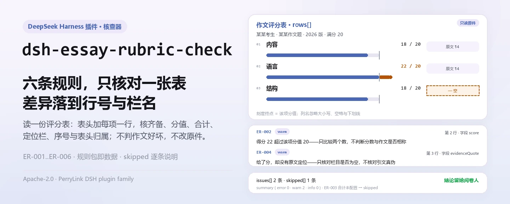
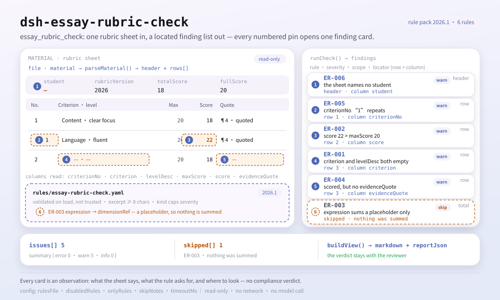

<div align="center">

<picture>
  <source media="(prefers-color-scheme: dark)" srcset="docs/assets/dsh-essay-rubric-check-hero-zh-dark.webp">
  
</picture>

# dsh-essay-rubric-check

**把作文评分表的每一处不自洽找出来——哪一行、哪一栏、差什么、怎么补。**

面向教研员、语文教师与阅卷组的评分表核对工具：读取学生表头加评分项明细，核对填写齐备、分值算术、原文定位、序号唯一与表头归属，只列差异，不替人下结论。

[安装](#三步上手) · [配置](#配置) · [FAQ](#faq) · [简体中文](README.md) · [English](README.en.md) · [Español](README.es.md) · [Português](README.pt.md) · [हिन्दी](README.hi.md)

[](LICENSE)
[](#兼容性)
[](https://www.npmjs.com/package/dsh-essay-rubric-check)
[](https://github.com/PerryLink/dsh-essay-rubric-check/actions/workflows/ci.yml)
[](#兼容性)

[](https://github.com/PerryLink/dsh-essay-rubric-check/stargazers)
[](https://www.npmjs.com/package/dsh-essay-rubric-check)
[](https://dshfind.com/plugins/PerryLink/dsh-essay-rubric-check?ref=badge)
[](https://securityscorecards.dev/viewer/?uri=github.com/PerryLink/dsh-essay-rubric-check)
[](https://dsh.market/)
[](https://gitee.com/perrylink/dsh-essay-rubric-check)

```sh
dsh plugin --profile <name> add dsh-essay-rubric-check
```

</div>

<sub>社区插件，与 DeepSeek 官方无关。唯一仓库：<https://github.com/PerryLink/dsh-essay-rubric-check>（Gitee 为镜像）。</sub>

## 它是什么

`dsh-essay-rubric-check` 读取一份**作文评分表**——学生表头加每个评分项一行——核对这张表自身的齐备、算术与依据：每个评分项是否填写了名称或等级描述、得分是否不超过该项分值、各评分项得分合计是否等于量表总分、给出得分的评分项是否留下原文定位、评分项序号是否唯一、表头是否声明学生与量表版本。它只列出能在材料里逐条指认的差异，不判断作文写得好不好、分数对不对、评语是否恰当。

它注册一个模型可调用的工具 `essay_rubric_check`：材料是 JSON 或 YAML（`file` 与 `material` 二选一），输出 `markdown` 报告、`reportJson` 与 `summary` 计数。无法执行的检查会逐条写进 `skipped`，不会被静默当作“没问题”。

适合教研员、语文教师与阅卷组：批量核对时把评分表导出为 JSON/YAML 交给它，原始文件只读，不改原件。

<picture>
  <source media="(prefers-color-scheme: dark)" srcset="docs/assets/dsh-essay-rubric-check-flow-v5-dark.svg">
  
</picture>

## 三步上手

1. **安装**（三选一）：

   ```sh
   # git 通道（最新 main；等价于 git+https://github.com/PerryLink/dsh-essay-rubric-check.git）
   dsh plugin --profile web add github:PerryLink/dsh-essay-rubric-check
   # npm 通道（已发布版本）
   dsh plugin --profile web add dsh-essay-rubric-check
   # tarball 通道：本仓库 pnpm pack 后（prepare 会先构建 lib/）
   dsh plugin --profile web add ./dsh-essay-rubric-check-<version>.tgz
   ```

2. **最小配置**（默认即可用；只在要停用规则、只跑部分规则或换规则包时才需要写）：

   ```yaml
   - insert:
       - id: dsh-essay-rubric-check
         name: dsh-essay-rubric-check
         config:
           disabledRules: []
           onlyRules: []
           timeoutMs: 120000
   ```

   `cordis.patch.yml` 只负责插入这一行；所有可调项都在 `src/config.ts` 的 Schemastery schema 里。

3. **验证已生效**：

   ```sh
   dsh --profile web --dump-config | grep -A2 'id: dsh-essay-rubric-check'
   node samples/quickstart/run.mjs
   ```

   样例 `ER-001-unsafe.json` 的期望结果是 1 条 warn、1 条 skipped（`ER-003` 未配置，见「FAQ」）。

**卸载**：`dsh plugin --profile web remove dsh-essay-rubric-check`（或从 profile patch 删掉该行）。

<details>
<summary>从 WorkBuddy / 扣子使用</summary>

在 WorkBuddy / 扣子搜「教学与点评核对包」（本检查是其中一项；上架以商城为准）。命令行安装仍是上面那一条。

</details>

## 核心能力

工具名 `essay_rubric_check`，读取“学生表头 + 每评分项一行”的评分表，套用版本化规则包，返回一份可逐条复核的报告。

- **六条内置规则** — 覆盖填写齐备、分值上限、合计、原文定位、序号唯一与表头归属；全部为 `warn`。
- **规则包是数据** — 规则写在 `rules/essay-rubric-check.yaml`，换文件即换规则集，无需改 TypeScript；规则包在加载期校验，不信任其内容。
- **无法执行不静默** — `skipped` 逐条写明规则 id 与原因；`summary` 给出 error / warn / info 计数，空问题列表不会被误读成“全部正确”。
- **只读、本地、无模型调用** — 纯解析与算术，不联网、不改原件、不调用模型。
- **两种输入形态** — `file`（JSON/YAML 绝对路径）或 `material`（内联文本）；`args.only` 可临时只跑指定规则。

### 规则

| 规则 | 核对什么 | 级别 | 依据类型 |
|---|---|---|---|
| `ER-001` | 评分项及其等级描述至少填写一项 | warn | principle |
| `ER-002` | 得分不超过该项分值 | warn | principle |
| `ER-003` | 各评分项得分合计等于量表总分（出厂默认未配置） | warn | principle |
| `ER-004` | 给出得分的评分项留下原文定位 | warn | principle |
| `ER-005` | 评分项序号唯一 | warn | principle |
| `ER-006` | 表头声明学生与量表版本 | warn | principle |

### 示例

**工具** `essay_rubric_check`

**输入**

~~~json
{"rows":[{"序号":"1","评分项":"","维度":"内容","等级描述":"","得分":"18", ...}]}
~~~

**输出**

~~~json
{
  "id": "dsh-essay-rubric-check.ER-001.de09b5a6",
  "ruleId": "ER-001",
  "severity": "warn",
  "locator": {
    "row": 1,
    "field": "criterion"
  },
  "found": "第 1 行 criterion、levelDesc 都为空",
  "expected": "criterion、levelDesc 至少应填写一项",
  "fix": "补填评分项与等级描述；本条只核对是否填写，不判断量表是否合理"
}
~~~

*Observed from `dsh-essay-rubric-check/tests/fixtures/ER-001/ER-001-unsafe.json; dsh-essay-rubric-check/tests/fixtures/ER-001/cases.json; dsh-essay-rubric-check/rules/essay-rubric-check.yaml; dsh-essay-rubric-check/tests/index.test.ts`*

| 你会问 | 它怎么答 |
|---|---|
| 某一项的得分超过了该项写明的分值，会怎样？ | `ER-002` 比较 `score` 与 `maxScore`，得分超过该项分值的行会被报出。它只比较这两个数，不判断这个分数与这篇作文是否相称：本插件看不到作文本身。 |
| 为什么合计那条规则出现在 `skipped` 里，什么都不报？ | `ER-003` 出厂即有意留白：算式指向占位字段 `dimensionRef`，因此不加总任何数，本条报告自己进了 `skipped`。把本机构量表的维度字段填进 `expression.fields`，或改为按明细行求和并与表头总分核对，它就会执行。本插件不替使用方假定总分的构成。 |
| 量表里两行用了同一个评分项序号。 | `ER-005` 会报出 `criterionNo` 的重复值，因为重复会让一个评分项看起来登记了两次。比较时忽略空白字符。同一维度分档打分是正常情形：请给每一档不同的序号，或停用本条。 |
| 某一项打了分，却没有摘录学生原句作为定位。 | `ER-004` 会报出该行：只有在 `score` 已填写时，它才要求 `evidenceQuote`。它核对定位栏是否填写，不核对所引原文是否真的出自该作文——编得像样的引文能通过本插件。 |
| 评分项名称与等级描述两栏都是空的。 | `ER-001` 要求一行至少填写 `criterion` 与 `levelDesc` 之一，两栏皆空的行会被报出。它只核对是否填了其中之一，不判断量表的分项设置是否科学、等级描述是否恰当。 |
| 评分表表头没有写明是哪个学生，也没写用的是哪一版量表。 | `ER-006` 要求表头声明 `student` 与 `rubricVersion`，缺哪个报哪个，因为分数无法归属，而量表换版时分数不可直接比较。这两项都是表头字段，按整张评分表核对一次，不逐行核对。若本机构表式还在表头记录评阅日期，把 `markedAt` 加进本条的 `fields` 即可。 |

### 材料格式

支持 JSON 与 YAML。列名匹配忽略大小写、空格、下划线与连字符；报告保留表格自己的列名，因此发现会指出它读到的是哪一栏。

```yaml
student: 某某考生
assignment: 某某作文题
rubricName: 某某作文评分量表
rubricVersion: 2026 版
totalScore: '18'
fullScore: '20'
markedAt: 2026-04-10
rows:
  - { 序号: '1', 评分项: 内容, 分值: '20',
      等级描述: 切合题意，中心突出，内容充实，感情真挚（一类卷 17—20 分）,
      得分: '18', 原文定位: '"他把那盏灯擦了三遍，直到玻璃上映出自己的影子。"',
      所在段落: 第 4 段, 评语: 以细节支撑情感，内容充实，符合一类卷标准。, 评分人: 王老师 }
```

### 依据的标准

| 文件 | 文号 | 引用它的规则 |
|---|---|---|
| 《普通高中语文课程标准》 | 现行版本与条号本次未核实 | ER-001, ER-002, ER-003, ER-005, ER-006 |
| 《普通高等学校招生全国统一考试评卷工作规定》 | 现行版本与条号本次未核实 | ER-004 |

**边界：** 本插件核对一份**作文评分表**的算术与证据——每个评分项是否写明名称与等级描述，得分是否不超过该项分值，各评分项得分合计是否等于量表总分，**给出得分的评分项是否留有摘自作文的引文**，评分项序号是否唯一，以及表格是否写明学生与量表版本。它**不**判定作文是否写得好、分数是否正确、评语是否恰当，也不判定某条评语是否应当复核。

> ### ⚠️ 在采信报告中的引文之前，请先读这一段
>
> **每条 `excerpt` 的状态逐条不同，不是统一的。** 有的规则引用逐字条文（`kind: direct`），有的按条文原则推导（`kind: derived-from-principle`，最高 `warn`），有的阈值由本机构配置（`kind: institutional-configuration`，最高 `info`）。规则包从不概括引文：取不到原文时，`excerpt` 会如实写明，推理写在 `note` 里；并有测试断言没有任何规则声称拥有它并不拥有的引文。**对仍标为「未取得原文」的规则，取得文本后必须把 `excerpt` 换成真实条款，并把 `kind` 提升为 `direct`。**
>
> 结论性判断留给审核人：本插件只列出材料内部可以逐条指认的差异，不判断事实真伪，也不评价合规性。

规则数据与代码分离：每条规则都带文件名、文号、按原文自身编号体系的条款号、逐字摘录与来源地址。加载期强制摘录必须是真实引文且不少于八个字符；仅由原则性条款推导的检查（`kind: derived-from-principle`）严重级上限 `warn`，由本机构配置阈值驱动的检查（`kind: institutional-configuration`）上限 `info`。核验中确认的边界与“刻意没有作出的结论”见随包的 `rules/evidence/` 目录。

## 配置

全部可调参数都在 `src/config.ts` 的 Schemastery schema 中，只改 profile 配置即可生效，无需改代码；逐条阈值在 `rules/` 下的规则库文件里。

| 键 | 类型 | 默认值 | 说明 |
|---|---|---|---|
| `rulesFile` | string | `rules/essay-rubric-check.yaml` | 规则库文件路径，相对插件包根目录 |
| `disabledRules` | string[] | `[]` | 要停用的规则 id 列表；每条都会出现在 `skipped` 中 |
| `onlyRules` | string[] | `[]` | 只执行这些规则 id；留空表示执行全部规则 |
| `skipNotes` | string | `""` | 附加到每条 `skipped` 说明后的备注 |
| `timeoutMs` | number | `120000` | 工具协作式超时预算（毫秒） |

<details>
<summary>规则级参数（改规则包，不改 Config）</summary>

- `ER-003` `expression` —— **必须先配置才会做事。** 二选一：列出本机构量表的维度字段
  （`{ "op": "sum", "fields": ["contentScore", "languageScore"] }`），或按明细行求和并对照表头总分；
  出厂算式指向占位字段，不计算任何数。
- `ER-002` `leftField` / `rightField` / `relation` —— 比较关系，默认 `score <= maxScore`。
- `ER-004` `conditionField` / `requiredFields` —— 什么条件下要求留下原文定位。

</details>

profile patch 覆盖示例：

```yaml
- insert:
    - id: dsh-essay-rubric-check
      name: dsh-essay-rubric-check
      config:
        onlyRules: [ER-001, ER-002, ER-004]
        skipNotes: 本次只核对填写、算术与定位
```

## FAQ

<details>
<summary>材料会被上传吗？数据存在哪？</summary>

不会上传。插件只读取传给工具的文档内容，不发网络请求、不带遥测、不做后台上报；除工具结果与 DSH 宿主自己的会话/日志存储外不写任何数据。宿主控制那份存储及其保留策略，本包不另存副本。卸载包只会移除代码，不会删除宿主会话日志或你已创建的文档。

</details>

<details>
<summary>为什么 `ER-003` 在 `skipped` 里？是不是漏算了？</summary>

不是漏算，是刻意留白。总分由哪些行相加取决于本机构量表怎么划分维度（内容／结构／语言／书写，或其他分法），所以出厂算式指向占位字段 `dimensionRef`，**不计算任何数**，并如实报告自己进了 `skipped`。把 `expression.fields` 改成本机构量表的维度字段，或改为按明细行求和并与表头总分核对，它就会执行。**本插件不替使用方假定总分的构成。**

</details>

<details>
<summary>编造的原文定位能通过吗？</summary>

能。`ER-004` 只核对“给了分就应当有定位”这一栏是否填写，从不核对引文是否真的出自这篇作文——比较需要作文原文，而插件看不到作文。编得像样的引文会通过本条。

</details>

<details>
<summary>性能开销多大？</summary>

解析一份评分表加六条规则的字面核对，纯本地算术，无网络请求、不调用模型；`timeoutMs` 只是工具协作式超时预算，默认 120 秒，正常材料远用不到。

</details>

<details>
<summary>会和其他插件抢工具名或服务吗？</summary>

不会。只注册 `essay_rubric_check` 一个工具，不提供 service key、不注册命令、不注册客户端 slot、不注册 HTTP 路由、不改全局对象；注册随插件卸载自动撤销。详见「与其他 DSH 插件的互操作性」。

</details>

## 故障排查

- **`ER-003` 报告自己 skipped。** 它的算式仍指向占位字段。配置维度字段或明细行求和形态——插件不会替你假定总分的构成。
- **`ER-004` 放过了一条编造的引文。** 它只核对引文是否**存在**，从不核对是否出现在作文里；比较需要作文，而插件看不到。
- **`ER-004` 在某个本不需要引文的评分项上报错。** 停用该规则，或把该评分项拆成独立量表。
- **`ER-002` 在得分正好等于满分时报错。** 相等是允许的；报错意味着得分更大。
- **`ER-005` 在同一维度的两行上报错。** 同一维度内分档打分是正常情形——给每一档不同的序号。
- **插件装上了但工具不出现。** 确认 `main` 指向 `lib/index.mjs`，且 `pnpm run build` 已生成该文件；`main` 写错会让加载器静默跳过条目。
- **`dsh plugin add` 报版本不兼容。** peer 范围覆盖 `0.1.x` 与 `0.2.x`；若运行时在其之外，可显式豁免：`dsh plugin --profile <name> allow-version dsh-essay-rubric-check@0.2.10 --dsh-version <runtime> --accept-risk`。
- **`check` 报 `manifest-peers` 失败。** 静态检查器比对的是一份早于 0.2 世代的硬编码 peer 范围；安装期的 peer 校验以运行时为准。这是 `dsh-plugin-dev` 的已知上游问题。

## 安全边界与已知限制

- **只看评分表，不看作答。** `ER-002` 只比较两个数，不判断分数与作文是否相称；`ER-004` 只核对定位栏是否填写，不核对引文真伪。这两条能力边界是本插件最重要的限制。
- **不判合规、不认定责任、不替代审核人。** 报告只列出材料内部可以逐条指认的差异，并始终携带免责声明；结论留给评分者与阅卷质量管理。
- **引文状态逐条不同，且多数尚未取得原文。** 规则包在每条 `excerpt` 里如实写明“该条文本未取得”，并按证据封顶：`derived-from-principle` 最高 `warn`，`institutional-configuration` 最高 `info`，只有 `direct` 才允许 `error`。测试断言没有任何规则声称拥有它并不拥有的引文；取得真实条款后应替换 `excerpt` 并把 `kind` 提升为 `direct`。
- **`ER-003` 默认不计算总分。** 出厂表达式指向占位字段 `dimensionRef`；不配置就不会有合计核对，且会在 `skipped` 中明说，而不是静默通过。
- **空问题列表不等于“没问题”。** 每条无法执行的检查都会出现在 `skipped` 并写明原因；规则要求列表未设置时，规则报告自己 `skipped`，而不是当作通过。
- **加载期校验。** 摘录不足八个字符、严重级与依据类型不匹配的规则库会在加载期失败，不会产出一份看起来很有底气的报告。
- **只读与本地。** 只读输入文件，不写回原件；无网络请求、无遥测、不调用模型。

## 与其他 DSH 插件的互操作性

- **只注册一个工具。** `essay_rubric_check` 通过标准 `tools` 服务注册（`inject: ['tools']`），不注册 service key、命令、客户端 slot 或 HTTP 路由，也不改写任何全局对象。
- **注册即 effect。** 工具注册返回 disposer，插件卸载或热重载时自动撤销，不残留工具条目。
- **纯 ESM、零原生代码。** 不引入原生模块、不启动子进程、不建立网络连接，可与任意其他 DSH 插件同 profile 共存。
- **输入输出留在标准工具面。** 只消费调用方给出的 `file` / `material`，报告作为工具结果返回；不监听会话事件，不与其他插件争抢事件链。

## 兼容性

| 维度 | 状态 |
|---|---|
| Harness | 对等版本范围 `>=0.1.2-rc.1 <0.2.0 \|\| >=0.2.0-0 <0.3.0` —— 已实测同时接受 `0.2.0-rc.2` 与 `0.2.1-rc.2`。**已声明 `engines.dsh`**：0.2.1 起由宿主单独裁决，范围为 `>=0.2.1-0 <0.3.0` |
| Node | `^22.19.0 \|\| >=24.0.0` |
| 平台 | 全平台（纯 ESM；无原生代码、无联网、不调用模型） |
| 工具模式 | `native` / `ptc` 均可；批量核对多份评分表时建议 `ptc`，schema 成本只付一次 |

## 生态与质量

- [Gitee 镜像](https://gitee.com/perrylink/dsh-essay-rubric-check)（同步镜像，以 GitHub 为准）
- [dshfind 插件页](https://dshfind.com/plugins/PerryLink/dsh-essay-rubric-check)（安装量与排名）
- [OpenSSF Scorecard 报告](https://securityscorecards.dev/viewer/?uri=github.com/PerryLink/dsh-essay-rubric-check)（由 [.github/workflows/scorecard.yml](.github/workflows/scorecard.yml) 驱动）
- [DSH Market](https://dsh.market/)（已上架）
- [生态知识库](https://perrylink.github.io/dsh-plugin-guide/)：插件开发指南 · 选型实测数据 · 维护取舍判据

## 开发

```sh
pnpm install
pnpm run typecheck
pnpm test
pnpm run build
pnpm run verify:self-contained
pnpm run check:lockfile
pnpm run check:readmes
pnpm run check:citations
node ../scripts/sync-shared.mjs dsh-essay-rubric-check
pnpm pack
```

插件是**数据驱动**的：`src/model.ts` 声明表格形状，共享 kit 提供读取器与检查引擎，规则包声明每一条检查。`node ../scripts/sync-shared.mjs dsh-essay-rubric-check` 把 `../_shared` 的共享件同步进 `src/shared/`；每次改动共享件后都要重跑。

五语文档由 `pnpm run check:readmes` 守住同一节数、同一条安装命令与同一组配置键。配图由 [`scripts/gen-readme-assets.py`](scripts/gen-readme-assets.py) 程序化生成（hero 深浅两版 webp + 结构图深浅两版 SVG），可重复执行。

## 家族与致谢

本项目是 [PerryLink](https://github.com/PerryLink) 维护的 DeepSeek Harness 插件家族成员（全部 Apache-2.0）。如果这个插件帮到了你，**给个 star**——它不解锁任何功能，但会让下一个人更容易找到它。

- [@PerryLink](https://github.com/PerryLink) —— 创建者与维护者：规则包、检查引擎、五语文档与 CI 门禁。

<details>
<summary>展开全部插件</summary>

| 插件 | 状态 |
|---|---|
| **[dsh-aqua-input-check](https://github.com/PerryLink/dsh-aqua-input-check)** |  |
| **[dsh-archive-check](https://github.com/PerryLink/dsh-archive-check)** |  |
| **[dsh-auto-review](https://github.com/PerryLink/dsh-auto-review)** |  |
| **[dsh-autotier](https://github.com/PerryLink/dsh-autotier)** | 🧊 已冻结 — 见仓库 README |
| **[dsh-bid-ca-precheck](https://github.com/PerryLink/dsh-bid-ca-precheck)** |  |
| **[dsh-bid-qual-check](https://github.com/PerryLink/dsh-bid-qual-check)** |  |
| **[dsh-cert-mcp](https://github.com/PerryLink/dsh-cert-mcp)** | 🧊 已冻结 — 见仓库 README |
| **[dsh-checkpoint-rewind](https://github.com/PerryLink/dsh-checkpoint-rewind)** |  |
| **[dsh-click](https://github.com/PerryLink/dsh-click)** |  |
| **[dsh-composer-history](https://github.com/PerryLink/dsh-composer-history)** |  |
| **[dsh-contract-stance](https://github.com/PerryLink/dsh-contract-stance)** |  |
| **[dsh-customs-doc-check](https://github.com/PerryLink/dsh-customs-doc-check)** |  |
| **[dsh-data-quality](https://github.com/PerryLink/dsh-data-quality)** | 🧊 已冻结 — 见仓库 README |
| **[dsh-demurrage-ledger](https://github.com/PerryLink/dsh-demurrage-ledger)** |  |
| **[dsh-doublecheck](https://github.com/PerryLink/dsh-doublecheck)** |  |
| **[dsh-drill-script-check](https://github.com/PerryLink/dsh-drill-script-check)** |  |
| **[dsh-eia-guide-check](https://github.com/PerryLink/dsh-eia-guide-check)** |  |
| **[dsh-emergency-plan](https://github.com/PerryLink/dsh-emergency-plan)** |  |
| **[dsh-essay-rubric-check](https://github.com/PerryLink/dsh-essay-rubric-check)** |  |
| **[dsh-evidence-check](https://github.com/PerryLink/dsh-evidence-check)** |  |
| **[dsh-export-ctl-check](https://github.com/PerryLink/dsh-export-ctl-check)** |  |
| **[dsh-fast](https://github.com/PerryLink/dsh-fast)** |  |
| **[dsh-fmea-table-check](https://github.com/PerryLink/dsh-fmea-table-check)** |  |
| **[dsh-forecast-penalty](https://github.com/PerryLink/dsh-forecast-penalty)** |  |
| **[dsh-fund-research](https://github.com/PerryLink/dsh-fund-research)** |  |
| **[dsh-github](https://github.com/PerryLink/dsh-github)** |  |
| **[dsh-gongwen-flow-check](https://github.com/PerryLink/dsh-gongwen-flow-check)** |  |
| **[dsh-gongwen-word-check](https://github.com/PerryLink/dsh-gongwen-word-check)** |  |
| **[dsh-guard-plan-qc](https://github.com/PerryLink/dsh-guard-plan-qc)** |  |
| **[dsh-hazchem-check](https://github.com/PerryLink/dsh-hazchem-check)** |  |
| **[dsh-hazplan-check](https://github.com/PerryLink/dsh-hazplan-check)** |  |
| **[dsh-hidden-risk-map](https://github.com/PerryLink/dsh-hidden-risk-map)** |  |
| **[dsh-hs-classify](https://github.com/PerryLink/dsh-hs-classify)** |  |
| **[dsh-icd-rule-check](https://github.com/PerryLink/dsh-icd-rule-check)** |  |
| **[dsh-industry-research](https://github.com/PerryLink/dsh-industry-research)** |  |
| **[dsh-lawcite-adapter](https://github.com/PerryLink/dsh-lawcite-adapter)** |  |
| **[dsh-laya](https://github.com/PerryLink/dsh-laya)** |  |
| **[dsh-lc-doc-check](https://github.com/PerryLink/dsh-lc-doc-check)** |  |
| **[dsh-learning-gap-check](https://github.com/PerryLink/dsh-learning-gap-check)** |  |
| **[dsh-library](https://github.com/PerryLink/dsh-library)** |  |
| **[dsh-local-ai](https://github.com/PerryLink/dsh-local-ai)** |  |
| **[dsh-lsp-actions](https://github.com/PerryLink/dsh-lsp-actions)** |  |
| **[dsh-mask](https://github.com/PerryLink/dsh-mask)** |  |
| **[dsh-mcp-panel](https://github.com/PerryLink/dsh-mcp-panel)** |  |
| **[dsh-medrec-qc](https://github.com/PerryLink/dsh-medrec-qc)** |  |
| **[dsh-memento](https://github.com/PerryLink/dsh-memento)** | 🧊 已冻结 — 见仓库 README |
| **[dsh-nsfc-form-check](https://github.com/PerryLink/dsh-nsfc-form-check)** |  |
| **[dsh-nurse-record-check](https://github.com/PerryLink/dsh-nurse-record-check)** |  |
| **[dsh-observe](https://github.com/PerryLink/dsh-observe)** |  |
| **[dsh-origin-rvc-check](https://github.com/PerryLink/dsh-origin-rvc-check)** |  |
| **[dsh-ota-review-check](https://github.com/PerryLink/dsh-ota-review-check)** |  |
| **[dsh-output-styles](https://github.com/PerryLink/dsh-output-styles)** |  |
| **[dsh-paper-doc-adapter](https://github.com/PerryLink/dsh-paper-doc-adapter)** |  |
| **[dsh-permission-rules](https://github.com/PerryLink/dsh-permission-rules)** |  |
| **[dsh-permit-report-check](https://github.com/PerryLink/dsh-permit-report-check)** |  |
| **[dsh-pipeline-check](https://github.com/PerryLink/dsh-pipeline-check)** |  |
| **[dsh-pleading-draft](https://github.com/PerryLink/dsh-pleading-draft)** |  |
| **[dsh-plugin-doctor](https://github.com/PerryLink/dsh-plugin-doctor)** | 🚫 已退役（仓库已归档） |
| **[dsh-plugin-guide](https://github.com/PerryLink/dsh-plugin-guide)** |  |
| **[dsh-plugin-kit](https://github.com/PerryLink/dsh-plugin-kit)** | 🚫 已退役（仓库已归档） |
| **[dsh-plugin-upgrade](https://github.com/PerryLink/dsh-plugin-upgrade)** | 🚫 已退役（仓库已归档） |
| **[dsh-policy-brief-draft](https://github.com/PerryLink/dsh-policy-brief-draft)** |  |
| **[dsh-power-loss-split](https://github.com/PerryLink/dsh-power-loss-split)** |  |
| **[dsh-power-ticket-check](https://github.com/PerryLink/dsh-power-ticket-check)** |  |
| **[dsh-ppap-check](https://github.com/PerryLink/dsh-ppap-check)** |  |
| **[dsh-protest-deadline](https://github.com/PerryLink/dsh-protest-deadline)** |  |
| **[dsh-railway-window](https://github.com/PerryLink/dsh-railway-window)** |  |
| **[dsh-repair-order-qc](https://github.com/PerryLink/dsh-repair-order-qc)** |  |
| **[dsh-research-report](https://github.com/PerryLink/dsh-research-report)** |  |
| **[dsh-review-reply-check](https://github.com/PerryLink/dsh-review-reply-check)** |  |
| **[dsh-rulefile-check](https://github.com/PerryLink/dsh-rulefile-check)** |  |
| **[dsh-safety-brief-check](https://github.com/PerryLink/dsh-safety-brief-check)** |  |
| **[dsh-score](https://github.com/PerryLink/dsh-score)** | 🧊 已冻结 — 见仓库 README |
| **[dsh-session-sync](https://github.com/PerryLink/dsh-session-sync)** |  |
| **[dsh-site-log-check](https://github.com/PerryLink/dsh-site-log-check)** |  |
| **[dsh-skill-pack-security](https://github.com/PerryLink/dsh-skill-pack-security)** |  |
| **[dsh-soe-decision-check](https://github.com/PerryLink/dsh-soe-decision-check)** |  |
| **[dsh-soilwater-check](https://github.com/PerryLink/dsh-soilwater-check)** |  |
| **[dsh-sop-sync-check](https://github.com/PerryLink/dsh-sop-sync-check)** |  |
| **[dsh-spc-gbt-adapter](https://github.com/PerryLink/dsh-spc-gbt-adapter)** |  |
| **[dsh-talk](https://github.com/PerryLink/dsh-talk)** |  |
| **[dsh-tender-extract](https://github.com/PerryLink/dsh-tender-extract)** |  |
| **[dsh-tender-matrix](https://github.com/PerryLink/dsh-tender-matrix)** |  |
| **[dsh-test-drive](https://github.com/PerryLink/dsh-test-drive)** |  |
| **[dsh-ticktick](https://github.com/PerryLink/dsh-ticktick)** | 🚫 已退役（仓库已归档） |
| **[dsh-translate](https://github.com/PerryLink/dsh-translate)** |  |
| **[dsh-warranty-calc](https://github.com/PerryLink/dsh-warranty-calc)** |  |
| **[dsh-budget](https://github.com/PerryLink/dsh-budget)** | 🧊 已冻结 — 见仓库 README |
| **[dsh-claude-move](https://github.com/PerryLink/dsh-claude-move)** | 🧊 已冻结 — 见仓库 README |
| **[dsh-defend](https://github.com/PerryLink/dsh-defend)** | 🧊 已冻结 — 见仓库 README |
| **[dsh-draw](https://github.com/PerryLink/dsh-draw)** | 🧊 已冻结 — 见仓库 README |
| **[dsh-reach](https://github.com/PerryLink/dsh-reach)** | 🧊 已冻结 — 见仓库 README |
| **[dsh-background-agents](https://github.com/PerryLink/dsh-background-agents)** | 🚫 已退役（仓库已归档） |
| **[dsh-session-pin](https://github.com/PerryLink/dsh-session-pin)** | 🚫 已退役（仓库已归档） |
| **[dsh-team-rooms](https://github.com/PerryLink/dsh-team-rooms)** | 🚫 已退役（仓库已归档） |

</details>

## License

[LICENSE](LICENSE)（Apache License 2.0）© 2026 dsh-essay-rubric-check contributors

<p align="center"><sub>Apache-2.0 · 社区插件，与 DeepSeek 无关。</sub></p>
