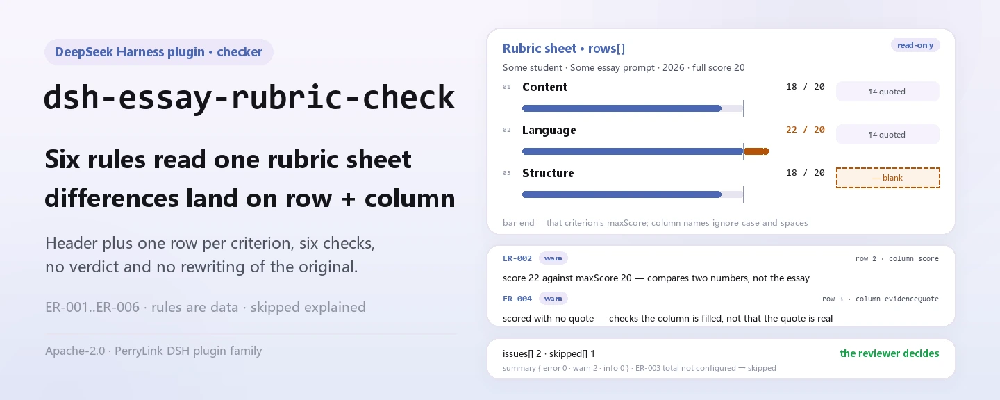

<div align="center">

<picture>
  <source media="(prefers-color-scheme: dark)" srcset="docs/assets/dsh-essay-rubric-check-hero-en-dark.webp">
  
</picture>

# dsh-essay-rubric-check

**Transforme uma folha de rubrica de redação em uma lista ponto a ponto do que não fecha: qual linha, qual coluna, o que falta e como corrigir.**

Uma ferramenta de verificação de folhas de pontuação para pesquisadores de ensino, professores de língua chinesa e equipes de correção: lê o cabeçalho do aluno mais uma linha por critério, verifica completude, aritmética, rastro de evidência, unicidade dos números de critério e atribuição da folha, e lista as diferenças sem decidir nada pelo revisor.

[Instalar](#instalação-em-três-passos) · [Configuração](#configuração) · [FAQ](#faq) · [简体中文](README.md) · [English](README.en.md) · [Español](README.es.md) · [Português](README.pt.md) · [हिन्दी](README.hi.md)

[](LICENSE)
[](#compatibilidade)
[](https://www.npmjs.com/package/dsh-essay-rubric-check)
[](https://github.com/PerryLink/dsh-essay-rubric-check/actions/workflows/ci.yml)
[](#compatibilidade)

[](https://github.com/PerryLink/dsh-essay-rubric-check/stargazers)
[](https://www.npmjs.com/package/dsh-essay-rubric-check)
[](https://dshfind.com/plugins/PerryLink/dsh-essay-rubric-check?ref=badge)
[](https://securityscorecards.dev/viewer/?uri=github.com/PerryLink/dsh-essay-rubric-check)
[](https://dsh.market/)
[](https://gitee.com/perrylink/dsh-essay-rubric-check)

```sh
dsh plugin --profile <name> add dsh-essay-rubric-check
```

</div>

<sub>Plugin da comunidade, sem afiliação com a DeepSeek. Repositório canônico: <https://github.com/PerryLink/dsh-essay-rubric-check> (o Gitee é um espelho).</sub>

## O que é

`dsh-essay-rubric-check` lê uma **folha de rubrica de redação** — o cabeçalho do aluno mais uma linha por critério — e verifica a completude, a aritmética e o rastro de evidência dessa própria folha: se cada critério registra um nome ou uma descrição de nível, se uma pontuação não excede o máximo desse critério, se as pontuações dos critérios somam a pontuação da rubrica, se cada critério pontuado deixa uma citação textual, se os números de critério não se repetem e se a folha declara o seu aluno e a sua versão de rubrica. Lista apenas as diferenças que consegue apontar no material; não decide se a redação está bem escrita, se a pontuação está correta nem se o comentário é adequado.

Registra uma ferramenta visível ao modelo, `essay_rubric_check`: o material é JSON ou YAML (`file` e `material` são mutuamente exclusivos) e a saída é um relatório `markdown` mais `reportJson` e as contagens de `summary`. Toda verificação que não pôde ser executada aparece em `skipped` com o motivo; nunca é tratada em silêncio como "nada está errado".

Feita para pesquisadores de ensino, professores de língua chinesa e equipes de correção: exporte a folha para JSON/YAML e verifique em lote; o arquivo original é somente leitura e nunca é modificado.

<picture>
  <source media="(prefers-color-scheme: dark)" srcset="docs/assets/dsh-essay-rubric-check-flow-v5-dark.svg">
  
</picture>

## Instalação em três passos

1. **Instale** (escolha um canal):

   ```sh
   # canal git (último main; equivalente a git+https://github.com/PerryLink/dsh-essay-rubric-check.git)
   dsh plugin --profile web add github:PerryLink/dsh-essay-rubric-check
   # canal npm (versões publicadas)
   dsh plugin --profile web add dsh-essay-rubric-check
   # canal tarball: pnpm pack neste repo (o prepare constrói lib/ primeiro)
   dsh plugin --profile web add ./dsh-essay-rubric-check-<version>.tgz
   ```

2. **Configuração mínima** (os padrões funcionam; configure apenas para desativar regras, executar um subconjunto ou apontar para outro pacote de regras):

   ```yaml
   - insert:
       - id: dsh-essay-rubric-check
         name: dsh-essay-rubric-check
         config:
           disabledRules: []
           onlyRules: []
           timeoutMs: 120000
   ```

   O `cordis.patch.yml` apenas insere esta linha; todos os parâmetros ajustáveis ficam no esquema Schemastery de `src/config.ts`.

3. **Verifique se monta**:

   ```sh
   dsh --profile web --dump-config | grep -A2 'id: dsh-essay-rubric-check'
   node samples/quickstart/run.mjs
   ```

   Espera-se que o exemplo `ER-001-unsafe.json` produza 1 warn e 1 skipped (`ER-003` não está configurada; veja o FAQ).

**Desinstalar**: `dsh plugin --profile web remove dsh-essay-rubric-check` (ou remova a linha do patch do perfil).

<details>
<summary>Usar pelo WorkBuddy / Coze</summary>

Procure "Teaching and Review Suite" no WorkBuddy / Coze (esta verificação é uma das partes; disponibilidade conforme o catálogo). A instalação por linha de comando continua sendo a de cima.

</details>

## Capacidades principais

A ferramenta chama-se `essay_rubric_check`. Lê uma folha no formato "cabeçalho do aluno + uma linha por critério", aplica um pacote de regras versionado e devolve um relatório revisável linha a linha.

- **Seis regras integradas** — completude, teto de pontuação, total, evidência de citação, unicidade dos números e atribuição do cabeçalho; todas em `warn`.
- **O pacote de regras é dado** — as regras ficam em `rules/essay-rubric-check.yaml`; substituir o arquivo troca o conjunto de regras sem tocar em TypeScript. O pacote é validado ao carregar, não é presumido correto.
- **Sem omissões silenciosas** — `skipped` nomeia cada regra que não pôde rodar e o motivo; `summary` traz as contagens error / warn / info, de modo que uma lista vazia de problemas não pode ser lida como "tudo certo".
- **Somente leitura, local, sem chamada ao modelo** — análise e aritmética puras; sem rede, sem alterar o original e sem invocar o modelo.
- **Duas formas de entrada** — `file` (caminho absoluto JSON/YAML) ou `material` (texto embutido); `args.only` restringe a execução às regras indicadas.

### Regras

| Regra | O que verifica | Gravidade | Tipo de base |
|---|---|---|---|
| `ER-001` | o critério e a sua descrição de nível estão registrados | warn | principle |
| `ER-002` | uma pontuação não excede o máximo do critério | warn | principle |
| `ER-003` | os critérios somam a pontuação da rubrica (sem configuração por padrão) | warn | principle |
| `ER-004` | um critério pontuado deixa uma citação textual | warn | principle |
| `ER-005` | os números de critério são únicos | warn | principle |
| `ER-006` | a folha declara o seu aluno e a sua versão de rubrica | warn | principle |

### Exemplos

**Ferramenta** `essay_rubric_check`

**Entrada**

~~~json
{"rows":[{"序号":"1","评分项":"","维度":"内容","等级描述":"","得分":"18", ...}]}
~~~

**Saída**

~~~json
{
  "id": "dsh-essay-rubric-check.ER-001.de09b5a6",
  "ruleId": "ER-001",
  "severity": "warn",
  "locator": {
    "row": 1,
    "field": "criterion"
  },
  "found": "第 1 行 criterion、levelDesc 都为空",
  "expected": "criterion、levelDesc 至少应填写一项",
  "fix": "补填评分项与等级描述；本条只核对是否填写，不判断量表是否合理"
}
~~~

*Observado em `dsh-essay-rubric-check/tests/fixtures/ER-001/ER-001-unsafe.json; dsh-essay-rubric-check/tests/fixtures/ER-001/cases.json; dsh-essay-rubric-check/rules/essay-rubric-check.yaml; dsh-essay-rubric-check/tests/index.test.ts`*

| Você pergunta | O que ele responde |
|---|---|
| Um critério tem uma pontuação acima do máximo escrito para ele. O que acontece? | `ER-002` compara `score` com `maxScore` e assinala a linha em que a pontuação excede o máximo. Compara apenas esses dois números e não julga se essa pontuação é adequada a esta redação: o plugin nunca vê o texto. |
| Porque é que a regra do total aparece em `skipped` em vez de reportar algo? | `ER-003` é entregue deliberadamente sem configurar. A sua expressão aponta para um campo de preenchimento, `dimensionRef`, pelo que nada é somado e a regra reporta-se a si mesma em `skipped`. Indique os campos de dimensão da sua própria rubrica em `expression.fields`, ou mude para somar as linhas de detalhe contra o total do cabeçalho, e ela é executada. O plugin não assume como o seu total é composto. |
| O mesmo número de critério aparece em duas linhas da rubrica. | `ER-005` reporta um valor repetido em `criterionNo`, porque uma duplicação faz um critério parecer registado duas vezes. Ao comparar, ignora os espaços em branco. Pontuar uma dimensão por escalões é uma forma legítima: dê a cada escalão o seu próprio número, ou desative a regra. |
| Um critério tem pontuação mas nenhuma citação textual do texto. | `ER-004` reporta essa linha: só quando `score` está preenchido é que exige `evidenceQuote`. Verifica que a célula de localização está preenchida, não que a citação venha realmente dessa redação: uma citação inventada mas verosímil passa neste plugin. |
| Estão vazios tanto o nome do critério como a sua descrição de nível. | `ER-001` exige pelo menos um de `criterion` e `levelDesc` numa linha e reporta a linha em que ambos estão vazios. Apenas verifica que um deles está preenchido e não julga se os critérios da rubrica são sólidos nem se as suas descrições de nível são adequadas. |
| O cabeçalho da folha não diz a que aluno pertence nem que versão da rubrica foi usada. | `ER-006` exige que o cabeçalho declare `student` e `rubricVersion`, e reporta o que faltar, porque as pontuações não podem ser atribuídas e as versões da rubrica não são diretamente comparáveis. Ambos são campos de cabeçalho, verificados uma vez para a folha e não linha a linha. Se o seu formulário também registar no cabeçalho uma data de correção, acrescente `markedAt` aos `fields` da regra. |

### Formato do material

JSON ou YAML. Os nomes de coluna são comparados sem diferenciar maiúsculas e ignorando espaços, sublinhados e hífenes; os nomes de coluna da própria folha são preservados, portanto um achado nomeia a coluna que leu.

```yaml
student: 某某考生
assignment: 某某作文题
rubricName: 某某作文评分量表
rubricVersion: 2026 版
totalScore: '18'
fullScore: '20'
markedAt: 2026-04-10
rows:
  - { 序号: '1', 评分项: 内容, 分值: '20',
      等级描述: 切合题意，中心突出，内容充实，感情真挚（一类卷 17—20 分）,
      得分: '18', 原文定位: '"他把那盏灯擦了三遍，直到玻璃上映出自己的影子。"',
      所在段落: 第 4 段, 评语: 以细节支撑情感，内容充实，符合一类卷标准。, 评分人: 王老师 }
```

### Normas que segue

| Documento | Número | Regras que o citam |
|---|---|---|
| Chinese Language Curriculum Standards for Senior Secondary School | Versão vigente e número do artigo não verificados nesta passagem | ER-001, ER-002, ER-003, ER-005, ER-006 |
| National Unified Examination for Admissions to General Universities and Colleges — marking work regulations | Versão vigente e número do artigo não verificados nesta passagem | ER-004 |

**Boundary:** esta ferramenta verifica uma **folha de rubrica de redação** na sua aritmética e evidência: se cada critério se nomeia a si mesmo e à sua descrição de nível, se uma pontuação não excede o máximo do critério, se os critérios somam a pontuação da rubrica, se **um critério pontuado deixa uma citação textual da redação**, se os números de critério são únicos e se a folha declara o seu aluno e a sua versão de rubrica. **Não** decide se a redação está bem escrita, se a pontuação está correta, se o comentário é adequado nem se uma observação deve ser revista.

> ### ⚠️ Leia isto antes de confiar numa citação do relatório
>
> **O estado de `excerpt` é por regra, não uniforme.** Algumas regras citam o artigo literalmente (`kind: direct`), outras derivam do princípio dos artigos citados (`kind: derived-from-principle`, teto `warn`) e outras usam limites que a sua instituição configura (`kind: institutional-configuration`, teto `info`). O pacote nunca parafraseia uma citação: quando o texto não foi obtido, o campo `excerpt` diz isso e o raciocínio fica em `note`; um teste afirma que nenhuma regra reivindica uma citação que não tem. **Para qualquer regra ainda marcada como não obtida, substitua o `excerpt` pelo artigo real e eleve `kind` para `direct` quando tiver o texto.**
>
> A conclusão é do revisor: esta ferramenta lista diferenças que consegue apontar no material e não decide factos nem conformidade.

Os dados das regras ficam separados do código: cada regra traz documento, número, artigo na numeração própria da fonte, trecho literal e URL de origem. O carregador impõe que o trecho seja citação real de pelo menos oito caracteres; verificações derivadas apenas de princípio geral (`kind: derived-from-principle`) têm teto `warn`, e as que usam limites da instituição (`kind: institutional-configuration`) têm teto `info`. Os limites verificados e as conclusões deliberadamente **não** afirmadas estão em `rules/evidence/`.

## Configuração

Todos os parâmetros ajustáveis ficam no esquema Schemastery de `src/config.ts`, portanto mudam pela configuração do perfil sem editar código; os limites por regra ficam no pacote de regras sob `rules/`.

| Chave | Tipo | Padrão | Descrição |
|---|---|---|---|
| `rulesFile` | string | `rules/essay-rubric-check.yaml` | Caminho do pacote de regras, relativo à raiz do pacote |
| `disabledRules` | string[] | `[]` | Ids de regras a desativar; cada uma aparece em `skipped` |
| `onlyRules` | string[] | `[]` | Executar apenas estas regras; vazio executa todas |
| `skipNotes` | string | `""` | Nota acrescentada a cada motivo de `skipped` |
| `timeoutMs` | number | `120000` | Orçamento de tempo limite cooperativo da ferramenta |

<details>
<summary>Parâmetros por regra (editar o pacote de regras, não o Config)</summary>

- `ER-003` `expression` — **tem de ser configurado antes de fazer algo.** Ou nomeie os campos de dimensão
  (`{ "op": "sum", "fields": ["contentScore", "languageScore"] }`), ou some as linhas de detalhe contra o total
  do cabeçalho; a expressão de fábrica aponta para um campo de preenchimento e não calcula nada.
- `ER-002` `leftField` / `rightField` / `relation` — a comparação, `score <= maxScore` por padrão.
- `ER-004` `conditionField` / `requiredFields` — o que aciona a exigência de citação.

</details>

Exemplo de substituição no patch do perfil:

```yaml
- insert:
    - id: dsh-essay-rubric-check
      name: dsh-essay-rubric-check
      config:
        onlyRules: [ER-001, ER-002, ER-004]
        skipNotes: esta passagem verifica apenas completude, aritmética e evidência
```

## FAQ

<details>
<summary>O material é enviado? Onde ficam os dados?</summary>

Não. O plugin lê o conteúdo do documento entregue à sua ferramenta e não faz pedidos de rede, não inclui telemetria nem relatórios em segundo plano e não escreve nada fora do resultado da ferramenta e do armazenamento de sessão/registo do próprio host DSH. O host controla esse armazenamento e a sua retenção; este pacote não acrescenta uma segunda cópia. Desinstalar o pacote remove o seu código; não apaga os registos de sessão do host nem os documentos que já criou.

</details>

<details>
<summary>Porque é que `ER-003` está em `skipped`? O total está a ser omitido?</summary>

Está deliberadamente sem configurar, não é omissão. "Que linhas somam o total" depende de como a sua rubrica divide as dimensões (conteúdo / estrutura / língua / caligrafia, ou outra), por isso a expressão de fábrica aponta para um campo de preenchimento, `dimensionRef`, e **não calcula nada**; a regra reporta-se a si mesma em `skipped` em vez de adivinhar. Nomeie os campos de dimensão em `expression.fields`, ou mude para somar as linhas contra o total do cabeçalho, e a regra roda. **O plugin não assume como o seu total é composto.**

</details>

<details>
<summary>Uma citação inventada pode passar?</summary>

Sim. `ER-004` só verifica que a célula de localização está preenchida quando há pontuação; nunca verifica que a citação aparece na redação — comparar exige a redação, que o plugin não vê. Uma citação inventada mas verosímil passa nesta regra.

</details>

<details>
<summary>Qual é o custo de desempenho?</summary>

Analisar uma folha e seis verificações literais é aritmética local: sem pedidos de rede e sem chamadas ao modelo. `timeoutMs` é apenas o orçamento cooperativo de tempo limite, 120 segundos por padrão; o material normal fica muito abaixo.

</details>

<details>
<summary>Vai colidir com outros plugins por nomes de ferramenta ou serviços?</summary>

Não. Registra exatamente uma ferramenta, `essay_rubric_check`, e não fornece service key, comando, slot de cliente, rota HTTP nem mutação global; o registro é descartado com o plugin. Veja "Interoperabilidade com outros plugins DSH".

</details>

## Solução de problemas

- **`ER-003` reporta-se como skipped.** A sua expressão ainda aponta para o campo de preenchimento. Configure os campos de dimensão ou a forma de soma por linhas; o plugin não vai assumir como o seu total é composto.
- **`ER-004` deixou passar uma citação inventada.** Só verifica que a citação *existe*, nunca que aparece na redação; comparar exige a redação, que o plugin não vê.
- **`ER-004` dispara num critério que não precisa de citação.** Desative a regra ou separe esse critério numa rubrica própria.
- **`ER-002` dispara numa pontuação igual ao máximo.** A igualdade é permitida; um achado significa que a pontuação é maior.
- **`ER-005` dispara em duas linhas de uma mesma dimensão.** Linhas por escalões dentro de uma dimensão são legítimas: numere-as de forma diferente.
- **O plugin instala mas a ferramenta não aparece.** Confirme que `main` resolve para `lib/index.mjs` e que `pnpm run build` o gerou; um `main` errado faz o carregador ignorar a entrada em silêncio.
- **`dsh plugin add` recusa o pacote como incompatível.** O intervalo de peers cobre `0.1.x` e `0.2.x`; fora dele, conceda isenção explícita: `dsh plugin --profile <name> allow-version dsh-essay-rubric-check@0.2.10 --dsh-version <runtime> --accept-risk`.
- **`check` informa `manifest-peers` como falha.** O verificador estático compara com um intervalo de peers fixo anterior à linha 0.2. O runtime aplica a compatibilidade na instalação, portanto o intervalo declarado é o correto; é um problema conhecido do `dsh-plugin-dev`.

## Limites de segurança e limitações conhecidas

- **Vê a folha de rubrica, nunca a redação.** `ER-002` só compara dois números e não consegue julgar se uma pontuação corresponde ao texto; `ER-004` só verifica que a célula de localização está preenchida e não consegue validar a citação. Estes são os limites de capacidade mais importantes do plugin.
- **Sem veredicto de conformidade, sem imputação de responsabilidade, sem substituir o revisor.** O relatório lista diferenças que consegue apontar no material e sempre leva o aviso legal; a conclusão pertence a quem corrige e à gestão da qualidade da correção.
- **O estado das citações é por regra e a maioria dos artigos não foi obtida.** O pacote declara "o texto do artigo não foi obtido" em cada `excerpt` e limita a gravidade pela evidência: `derived-from-principle` em `warn`, `institutional-configuration` em `info`, e só `direct` pode levar `error`. Um teste afirma que nenhuma regra reivindica uma citação que não tem; quando tiver o artigo real, substitua o `excerpt` e eleve `kind` para `direct`.
- **`ER-003` não calcula nenhum total por padrão.** A expressão de fábrica aponta para o campo de preenchimento `dimensionRef`; sem configuração não há verificação do total, e a regra di-lo em `skipped` em vez de passar em silêncio.
- **Uma lista vazia de problemas nunca significa "nada está errado".** Toda verificação que não pôde rodar aparece em `skipped` com o motivo; uma regra cuja lista de requisitos não está configurada reporta-se em `skipped` em vez de passar.
- **Validação ao carregar.** Um pacote cujo trecho tenha menos de oito caracteres ou cuja gravidade exceda o tipo de base falha ao carregar em vez de produzir um relatório com aparência de solidez.
- **Somente leitura e local.** Lê o arquivo de entrada e nunca reescreve o original; não há pedidos de rede, telemetria nem chamadas ao modelo.

## Interoperabilidade com outros plugins DSH

- **Uma única ferramenta.** `essay_rubric_check` é registada pelo serviço padrão `tools` (`inject: ['tools']`); o plugin não fornece service key, comando, slot de cliente nem rota HTTP, e não altera nenhum objeto global.
- **O registro é um effect.** O registro devolve um disposer, portanto descarregar ou recarregar a quente o plugin remove a entrada da ferramenta sem resíduos.
- **ESM puro, sem código nativo.** Não incorpora módulos nativos, não inicia subprocessos e não abre conexões de rede, pelo que pode partilhar perfil com qualquer outro plugin DSH.
- **A E/S fica na superfície padrão de ferramentas.** Consome apenas o `file` / `material` do chamador e devolve o relatório como resultado da ferramenta; não escuta eventos de sessão nem compete por cadeias de eventos.

## Compatibilidade

| Superfície | Estado |
|---|---|
| Harness | Intervalo de peers `>=0.1.2-rc.1 <0.2.0 \|\| >=0.2.0-0 <0.3.0` — verificado para aceitar tanto `0.2.0-rc.2` como `0.2.1-rc.2`. **`engines.dsh` é declarado como `>=0.2.1-0 <0.3.0`** e o host aplica-o desde 0.2.1 |
| Node | `^22.19.0 \|\| >=24.0.0` |
| Plataformas | Todas (ESM puro; sem código nativo, sem rede, sem chamada ao modelo) |
| Modo de ferramenta | Funciona em `native` e `ptc`; para verificar várias folhas em lote use `ptc`, assim o custo do esquema é pago uma vez |

## Ecossistema e qualidade

- [Espelho no Gitee](https://gitee.com/perrylink/dsh-essay-rubric-check) (espelho sincronizado; o GitHub é a referência)
- [Página no dshfind](https://dshfind.com/plugins/PerryLink/dsh-essay-rubric-check) (instalações e posição)
- [Relatório OpenSSF Scorecard](https://securityscorecards.dev/viewer/?uri=github.com/PerryLink/dsh-essay-rubric-check) (movido por [.github/workflows/scorecard.yml](.github/workflows/scorecard.yml))
- [DSH Market](https://dsh.market/) (listado)
- [Base de conhecimento do ecossistema](https://perrylink.github.io/dsh-plugin-guide/): guia de desenvolvimento de plugins · medições de seleção · critérios de manutenção

## Desenvolvimento

```sh
pnpm install
pnpm run typecheck
pnpm test
pnpm run build
pnpm run verify:self-contained
pnpm run check:lockfile
pnpm run check:readmes
pnpm run check:citations
node ../scripts/sync-shared.mjs dsh-essay-rubric-check
pnpm pack
```

O plugin é **orientado a dados**: `src/model.ts` declara a forma da tabela, o kit partilhado fornece o leitor e o motor de verificação, e o pacote de regras declara cada verificação. `node ../scripts/sync-shared.mjs dsh-essay-rubric-check` copia o kit partilhado de `../_shared` para `src/shared/`; execute-o novamente após cada alteração partilhada.

`pnpm run check:readmes` mantém os cinco READMEs com o mesmo número de secções, o mesmo comando de instalação e as mesmas chaves de configuração. As figuras são geradas por [`scripts/gen-readme-assets.py`](scripts/gen-readme-assets.py) (capa em WebP clara e escura, diagrama de estrutura em SVG claro e escuro) e podem ser regeneradas a qualquer momento.

## Família e agradecimentos

Este projeto é membro da família de plugins DeepSeek Harness mantida pela [PerryLink](https://github.com/PerryLink) (todos Apache-2.0). Se este plugin ajudou você, **dê uma estrela** — não desbloqueia nada, mas ajuda a próxima pessoa a encontrá-lo.

- [@PerryLink](https://github.com/PerryLink) — criador e mantenedor: pacote de regras, motor de verificação, documentação em cinco idiomas e portões de CI.

<details>
<summary>Mostrar todos os plugins</summary>

| Plugin | Estado |
|---|---|
| **[dsh-aqua-input-check](https://github.com/PerryLink/dsh-aqua-input-check)** |  |
| **[dsh-archive-check](https://github.com/PerryLink/dsh-archive-check)** |  |
| **[dsh-auto-review](https://github.com/PerryLink/dsh-auto-review)** |  |
| **[dsh-autotier](https://github.com/PerryLink/dsh-autotier)** | 🧊 CONGELADO — ver o README do repo |
| **[dsh-bid-ca-precheck](https://github.com/PerryLink/dsh-bid-ca-precheck)** |  |
| **[dsh-bid-qual-check](https://github.com/PerryLink/dsh-bid-qual-check)** |  |
| **[dsh-cert-mcp](https://github.com/PerryLink/dsh-cert-mcp)** | 🧊 CONGELADO — ver o README do repo |
| **[dsh-checkpoint-rewind](https://github.com/PerryLink/dsh-checkpoint-rewind)** |  |
| **[dsh-click](https://github.com/PerryLink/dsh-click)** |  |
| **[dsh-composer-history](https://github.com/PerryLink/dsh-composer-history)** |  |
| **[dsh-contract-stance](https://github.com/PerryLink/dsh-contract-stance)** |  |
| **[dsh-customs-doc-check](https://github.com/PerryLink/dsh-customs-doc-check)** |  |
| **[dsh-data-quality](https://github.com/PerryLink/dsh-data-quality)** | 🧊 CONGELADO — ver o README do repo |
| **[dsh-demurrage-ledger](https://github.com/PerryLink/dsh-demurrage-ledger)** |  |
| **[dsh-doublecheck](https://github.com/PerryLink/dsh-doublecheck)** |  |
| **[dsh-drill-script-check](https://github.com/PerryLink/dsh-drill-script-check)** |  |
| **[dsh-eia-guide-check](https://github.com/PerryLink/dsh-eia-guide-check)** |  |
| **[dsh-emergency-plan](https://github.com/PerryLink/dsh-emergency-plan)** |  |
| **[dsh-essay-rubric-check](https://github.com/PerryLink/dsh-essay-rubric-check)** |  |
| **[dsh-evidence-check](https://github.com/PerryLink/dsh-evidence-check)** |  |
| **[dsh-export-ctl-check](https://github.com/PerryLink/dsh-export-ctl-check)** |  |
| **[dsh-fast](https://github.com/PerryLink/dsh-fast)** |  |
| **[dsh-fmea-table-check](https://github.com/PerryLink/dsh-fmea-table-check)** |  |
| **[dsh-forecast-penalty](https://github.com/PerryLink/dsh-forecast-penalty)** |  |
| **[dsh-fund-research](https://github.com/PerryLink/dsh-fund-research)** |  |
| **[dsh-github](https://github.com/PerryLink/dsh-github)** |  |
| **[dsh-gongwen-flow-check](https://github.com/PerryLink/dsh-gongwen-flow-check)** |  |
| **[dsh-gongwen-word-check](https://github.com/PerryLink/dsh-gongwen-word-check)** |  |
| **[dsh-guard-plan-qc](https://github.com/PerryLink/dsh-guard-plan-qc)** |  |
| **[dsh-hazchem-check](https://github.com/PerryLink/dsh-hazchem-check)** |  |
| **[dsh-hazplan-check](https://github.com/PerryLink/dsh-hazplan-check)** |  |
| **[dsh-hidden-risk-map](https://github.com/PerryLink/dsh-hidden-risk-map)** |  |
| **[dsh-hs-classify](https://github.com/PerryLink/dsh-hs-classify)** |  |
| **[dsh-icd-rule-check](https://github.com/PerryLink/dsh-icd-rule-check)** |  |
| **[dsh-industry-research](https://github.com/PerryLink/dsh-industry-research)** |  |
| **[dsh-lawcite-adapter](https://github.com/PerryLink/dsh-lawcite-adapter)** |  |
| **[dsh-laya](https://github.com/PerryLink/dsh-laya)** |  |
| **[dsh-lc-doc-check](https://github.com/PerryLink/dsh-lc-doc-check)** |  |
| **[dsh-learning-gap-check](https://github.com/PerryLink/dsh-learning-gap-check)** |  |
| **[dsh-library](https://github.com/PerryLink/dsh-library)** |  |
| **[dsh-local-ai](https://github.com/PerryLink/dsh-local-ai)** |  |
| **[dsh-lsp-actions](https://github.com/PerryLink/dsh-lsp-actions)** |  |
| **[dsh-mask](https://github.com/PerryLink/dsh-mask)** |  |
| **[dsh-mcp-panel](https://github.com/PerryLink/dsh-mcp-panel)** |  |
| **[dsh-medrec-qc](https://github.com/PerryLink/dsh-medrec-qc)** |  |
| **[dsh-memento](https://github.com/PerryLink/dsh-memento)** | 🧊 CONGELADO — ver o README do repo |
| **[dsh-nsfc-form-check](https://github.com/PerryLink/dsh-nsfc-form-check)** |  |
| **[dsh-nurse-record-check](https://github.com/PerryLink/dsh-nurse-record-check)** |  |
| **[dsh-observe](https://github.com/PerryLink/dsh-observe)** |  |
| **[dsh-origin-rvc-check](https://github.com/PerryLink/dsh-origin-rvc-check)** |  |
| **[dsh-ota-review-check](https://github.com/PerryLink/dsh-ota-review-check)** |  |
| **[dsh-output-styles](https://github.com/PerryLink/dsh-output-styles)** |  |
| **[dsh-paper-doc-adapter](https://github.com/PerryLink/dsh-paper-doc-adapter)** |  |
| **[dsh-permission-rules](https://github.com/PerryLink/dsh-permission-rules)** |  |
| **[dsh-permit-report-check](https://github.com/PerryLink/dsh-permit-report-check)** |  |
| **[dsh-pipeline-check](https://github.com/PerryLink/dsh-pipeline-check)** |  |
| **[dsh-pleading-draft](https://github.com/PerryLink/dsh-pleading-draft)** |  |
| **[dsh-plugin-doctor](https://github.com/PerryLink/dsh-plugin-doctor)** | 🚫 APOSENTADO (repo arquivado) |
| **[dsh-plugin-guide](https://github.com/PerryLink/dsh-plugin-guide)** |  |
| **[dsh-plugin-kit](https://github.com/PerryLink/dsh-plugin-kit)** | 🚫 APOSENTADO (repo arquivado) |
| **[dsh-plugin-upgrade](https://github.com/PerryLink/dsh-plugin-upgrade)** | 🚫 APOSENTADO (repo arquivado) |
| **[dsh-policy-brief-draft](https://github.com/PerryLink/dsh-policy-brief-draft)** |  |
| **[dsh-power-loss-split](https://github.com/PerryLink/dsh-power-loss-split)** |  |
| **[dsh-power-ticket-check](https://github.com/PerryLink/dsh-power-ticket-check)** |  |
| **[dsh-ppap-check](https://github.com/PerryLink/dsh-ppap-check)** |  |
| **[dsh-protest-deadline](https://github.com/PerryLink/dsh-protest-deadline)** |  |
| **[dsh-railway-window](https://github.com/PerryLink/dsh-railway-window)** |  |
| **[dsh-repair-order-qc](https://github.com/PerryLink/dsh-repair-order-qc)** |  |
| **[dsh-research-report](https://github.com/PerryLink/dsh-research-report)** |  |
| **[dsh-review-reply-check](https://github.com/PerryLink/dsh-review-reply-check)** |  |
| **[dsh-rulefile-check](https://github.com/PerryLink/dsh-rulefile-check)** |  |
| **[dsh-safety-brief-check](https://github.com/PerryLink/dsh-safety-brief-check)** |  |
| **[dsh-score](https://github.com/PerryLink/dsh-score)** | 🧊 CONGELADO — ver o README do repo |
| **[dsh-session-sync](https://github.com/PerryLink/dsh-session-sync)** |  |
| **[dsh-site-log-check](https://github.com/PerryLink/dsh-site-log-check)** |  |
| **[dsh-skill-pack-security](https://github.com/PerryLink/dsh-skill-pack-security)** |  |
| **[dsh-soe-decision-check](https://github.com/PerryLink/dsh-soe-decision-check)** |  |
| **[dsh-soilwater-check](https://github.com/PerryLink/dsh-soilwater-check)** |  |
| **[dsh-sop-sync-check](https://github.com/PerryLink/dsh-sop-sync-check)** |  |
| **[dsh-spc-gbt-adapter](https://github.com/PerryLink/dsh-spc-gbt-adapter)** |  |
| **[dsh-talk](https://github.com/PerryLink/dsh-talk)** |  |
| **[dsh-tender-extract](https://github.com/PerryLink/dsh-tender-extract)** |  |
| **[dsh-tender-matrix](https://github.com/PerryLink/dsh-tender-matrix)** |  |
| **[dsh-test-drive](https://github.com/PerryLink/dsh-test-drive)** |  |
| **[dsh-ticktick](https://github.com/PerryLink/dsh-ticktick)** | 🚫 APOSENTADO (repo arquivado) |
| **[dsh-translate](https://github.com/PerryLink/dsh-translate)** |  |
| **[dsh-warranty-calc](https://github.com/PerryLink/dsh-warranty-calc)** |  |
| **[dsh-budget](https://github.com/PerryLink/dsh-budget)** | 🧊 CONGELADO — ver o README do repo |
| **[dsh-claude-move](https://github.com/PerryLink/dsh-claude-move)** | 🧊 CONGELADO — ver o README do repo |
| **[dsh-defend](https://github.com/PerryLink/dsh-defend)** | 🧊 CONGELADO — ver o README do repo |
| **[dsh-draw](https://github.com/PerryLink/dsh-draw)** | 🧊 CONGELADO — ver o README do repo |
| **[dsh-reach](https://github.com/PerryLink/dsh-reach)** | 🧊 CONGELADO — ver o README do repo |
| **[dsh-background-agents](https://github.com/PerryLink/dsh-background-agents)** | 🚫 APOSENTADO (repo arquivado) |
| **[dsh-session-pin](https://github.com/PerryLink/dsh-session-pin)** | 🚫 APOSENTADO (repo arquivado) |
| **[dsh-team-rooms](https://github.com/PerryLink/dsh-team-rooms)** | 🚫 APOSENTADO (repo arquivado) |

</details>

## Licença

[LICENSE](LICENSE) (Apache License 2.0) © 2026 dsh-essay-rubric-check contributors

<p align="center"><sub>Apache-2.0 · Plugin da comunidade, sem afiliação com a DeepSeek.</sub></p>
